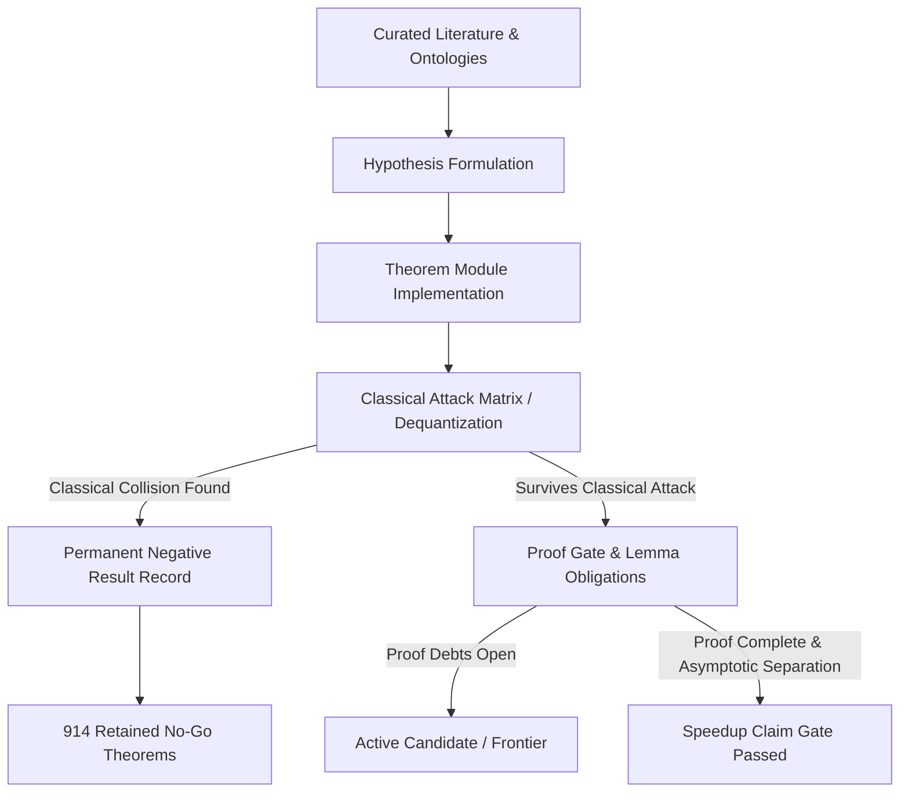

# Q-Search: Proof-Gated Quantum Algorithm Research Engine

[](https://github.com/Jaspersands/qsearch/actions/workflows/validate.yml)
[](https://jaspersands.github.io/qsearch/)
[](https://jaspersands.github.io/qsearch/)
[](https://jaspersands.github.io/qsearch/negative-results.html)

**Q-Search** is an automated, proof-gated research platform designed to investigate structural quantum algorithms for hard classical computational problems.

Rather than optimizing for small-scale demonstrations, toy circuits, or premature speedup claims on trivial instances, Q-Search systematically formulates high-upside quantum mechanisms, subjects them to automated classical attack suites, and permanently preserves negative results.

---

## Quick Navigation

- [Executive Summary](#executive-summary)
- [Live Research Dashboards](#live-research-dashboards)
- [Repository Architecture & Codebase Layout](#repository-architecture--codebase-layout)
- [Primary Research Tracks](#primary-research-tracks)
- [The Proof-Gated Operating System](#the-proof-gated-operating-system)
- [Getting Started & Quick Start](#getting-started--quick-start)
- [Categorized CLI Command Reference](#categorized-cli-command-reference)
- [Operating Contract & Model Allocation](#operating-contract--model-allocation)

---

## Executive Summary

The central question driving Q-Search is: **Can explicit computational structure support major quantum speedups after state preparation, readout, precision, and strong classical competitors are charged?**

### Current Research Decision

**Test constructive algorithms, not more surrounding infrastructure. No breakthrough algorithm is implemented.**

The [Goppa holdout audit](research/GOPPA_HOLDOUT_QUANTUM_ACCESS.md) now uses
the full GIJS and Weis papers, including the stronger matrix-free classical
baseline. `python qsearch.py holdout-jets --write` verifies exact finite-field
certificates. An actual jet-operator counterexample rejects the naive complex
linear-algebra shortcut; it is not a general quantum impossibility claim.

The [local-quotient formulation](research/GOPPA_LOCAL_QUOTIENT_PRESENTATION.md)
now gives exact public characteristic-two relations, with independent tests.
It does not yet give efficient global state preparation or quotient access.
The [number-field correction](research/ARBITRARY_DEGREE_NUMBER_FIELD_REGULATOR_BARRIER.md)
withdraws an incorrect exponential-degree barrier: published arbitrary-degree
quantum unit-group and principal-ideal algorithms must remain available as
research primitives. Their reuse is not a new algorithm discovered here.

The [arithmetic follow-up](research/UNMARKED_INTEGRAL_PENCIL_REDUCTION.md)
reduces a promised unmarked tensor problem to existing integral similarity
using classical preprocessing. A separately reviewed
[output-size theorem](research/INTEGRAL_SIMILARITY_OUTPUT_SIZE.md) proves
that even 2x2 inputs can require exponentially long expanded conjugators.
The [Amitsur audit](research/AMITSUR_ARITHMETIC_REUSE_AUDIT.md) records
existing quantum splitting machinery and its compact-output interface.
These are reusable reductions and safeguards, not a newly discovered speedup.
The [compact-residue follow-up](research/COMPACT_RESIDUE_CONDUCTOR_DECISION.md)
now supplies a reviewed way to consume compact units in conductor decisions
without expanding them, with exact YES and NO controls. It does not supply
a new quantum primitive or a hard native application.

The [quaternion follow-up](research/QUATERNION_NORM_SLICE_AND_LOCAL_FLAGS.md)
now specifies the exact norm target and a sufficient better-than-`sqrt(2)`
weighted short-vector guarantee for power-of-two centers. It also rejects
an explicit local-flag HSP wrapper using public linear algebra. A separate
[version-scoped source audit](research/QUATERNION_HSVP_PREPRINT_AUDIT.md)
records two independently checked preprint counterexamples and the stronger
QuaILLL classical baseline. No efficient algorithm reaching the target is
implemented or inferred from these checks.

The next [compact-orbit construction](research/QUATERNION_COMPACT_ORBIT_SOURCE.md)
supplies a native quaternion lattice signature with independently reviewed
separation and clean approximate preparation arguments. The missing step
is efficient end-to-end transporter reconstruction, not an assumed
short-vector sampler. Classical moment recovery is an explicit competitor.
An [integral-descent counterexample](research/QUATERNION_INTEGRAL_DESCENT.md)
shows why ordinary field principalization and rational splitting do not
finish this problem. These are proof-level results and exact controls,
not an implemented quantum oracle or a speedup. The direct Goppa CSS
postselection alternative is deprioritized after a native rank-cost check.

The [receiver analysis](research/QUATERNION_COVARIANT_RECEIVER.md) now
separates informative measurements from efficient decoding. Global
Clifford shadows give polynomial-size records at proof level, but no
polynomial decoder is known here. Ordinary Cartesian Fourier records
have a matched classical simulator. A valid swap-wreath reduction and
available high-spin rotation circuits clarify the remaining interfaces;
none completes a quantum algorithm for the native problem.

The [next receiver checks](research/QUATERNION_RECEIVER_CLASSICAL_FILTER.md)
deprioritize overlap optimization and matching-width parity features:
both have matched classical estimators. Discarding a whole embedding also
removes most branch coherence under explicit parameter bounds. These
results do not simulate full measurement records; efficient nonlinear
decoding remains open. No new quantum speedup is claimed.

The [arithmetic-score analysis](research/QUATERNION_ARITHMETIC_RECEIVER.md)
now gives exact measurement records, including cancellation zeros, and
a close Gaussian reference proxy with explicit encoding/error budgets.
A localized weak-cubic sum has a conditional fast evaluation route;
the native growing-dimensional scores do not yet meet its hypotheses.
The simpler record class occurs only with probability `1/(p+1)`, and
conditioning can destroy identifiability. Efficient score evaluation
and orientation reconstruction both remain open, not implementation chores.

A [nonabelian scope correction](research/COSET_MULTIPLICITY_CARRIER_TRILEMMA.md)
retracts an active, unsupported general no-go claim. Large multiplicity
spaces and noncommuting operators do not themselves imply exponential
quantum circuits. Physical information checks and structured-access controls
replace the faulty checks; a useful receiver for hard ensembles is still missing.

The dependent [CFI report](research/CFI_GRAPH_COSET_LUKS_SUBSUMPTION_BARRIER.md)
is also corrected: fixed-degree explicit graph isomorphism retains its
polynomial classical baseline, but the claimed universal quantum impossibility
and invented runtime comparisons are withdrawn. Actual graph and cycle-action
checks replace them; neither this correction nor the tests constitute a speedup.

The [wreath-source correction](research/WREATH_COSET_PERMUTATION_HOLEVO_COLLAPSE.md)
now includes a working classical recovery algorithm for its valid twisted-
diagonal source, using `binom(n,2)+n+1` opaque-label queries. The corrected
quantum states contain substantial information, but this source does not
provide a quantum advantage. The result does not solve general code equivalence.

A [four-agent geometric-source audit](research/WEAK_SIEGEL_CONVERSION_AUDIT.md)
now separates three unresolved steps: changing polarization, normalizing
weak torsion images, and recovering the gluing between elliptic factors.
A constructive matrix completion does not yield the required polarization;
its direct repair in dimension two forces the secret prime into the quotient budget.
Exact controls and conditional easier regimes are retained. The original
weak-input problem remains open, not classically broken or quantum-solved.

The latest [six-agent source/receiver review](research/audits/reviews/2026-10-30-six-agent-source-receiver-burst.md)
separates feasible state preparation from unestablished hard applications.
An [exact coherent-selector control](research/COHERENT_GRADE_SELECTOR.md)
rules out one proposed copy-saving shortcut, not collective receivers in
general. A constructive follow-up, the [invariant-Gram receiver](research/INVARIANT_GRAM_REES_RECEIVER.md),
now preserves the required coherence on a larger bank for the class-three
filiform family. Its public controller plans 14/16-source banks, while a
stronger verified sequential comparator uses 12/18. Thus there is no uniform
source improvement; the earlier 18/36 comparison was too weak. The full channel has an
independently reviewed analytical argument, not a compiled quantum receiver
or new asymptotic regime. Run `python qsearch.py power-sde --coherent-gram --write`.
The [high-rank follow-up](research/HIGH_RANK_GRAM_DECISION.md) rules out two
immediate shortcuts, not general receivers. This extension is deprioritized
until a new construction beats the complete sequential bound; a useful
native application remains the other scientific gate.

The latest [random-column Rees derivation](research/RANDOM_COLUMN_REES_PARAMETER_BOUND.md)
uses actual random character labels to give conditional all-prime parameter
factors `2^O(r log(r+2))` for derived dimension and `2^O(k log(k+2))` for
hidden codimension. Independent automated reviews found no fatal error;
the full Rees theorem, novelty and a useful hard application remain unverified.
The bounded classical kernel sampler, exact resource accounting and failure
controls are implemented, not the quantum receiver. Replay with
`python qsearch.py power-sde --random-column --write`.

A [correction to the incoming Rees review](research/manuscripts/REES_FOUR_PILLAR_CORRECTIONS.md)
separates explicit Lean hypotheses from axioms, upper bounds from lower
bounds, and valid classical tests from unsupported application-rejection
rules. The original review is preserved; novelty remains unestablished.

The latest [ring-to-field audit](research/UNIFORM_RING_TO_FIELD_RANK_REDUCTION.md)
changes the priority: the published outer reduction, reconstructed in
explicit Lie coordinates, preserves derived additive rank. Conditional on
the field theorem, this gives the stronger rank-only ring bound
`2^O(R log(R+2))*poly(full input bits)`. It does not require the new direct
mixed-order receiver. The residual scientific questions are the FIELD
theorem and a useful native application, not exponent bookkeeping. Replay
the p-torsion and exact terminal-readout controls with
`python qsearch.py prime-power-sde --rank-reduction --write`.

The [unit-power](research/UNIT_POWER_MODULE_CANCELLATION.md) and
[small-prime subset](research/SMALL_PRIME_REGULAR_SUBSET.md) methods remain
tested direct-arithmetic alternatives, not evidence of a new end-to-end
input regime. Their `--unit-kernel` and `--subset-kernel` replays are retained.

An earlier six-agent pass produced a [working classical attack](research/MERSENNE_SCALAR_FLAT_ATTACK.md)
on all three fixed Mersenne native search tests (two n17 inputs and one n31
input), with independent witness verification and no seed search. It does
not solve the asymptotic family or uniform sampling. The family is now
deprioritized as a quantum-breakthrough track; its useful mathematics and
precise unresolved questions are retained. Replay with
`python -m theorems.mersenne_scalar_flats --output research/classical_baselines/mersenne_scalar_flats.json`.

The preceding [Pauli-symmetry analysis](research/PAULI_CONJUGATION_SYMMETRY_LEARNING.md)
targets the full symmetry group of noisy stabilizer-diagonal states, including
noncommuting symmetries. Independent review replaced a longer construction
with a direct route using existing skew Bell machinery and paid verification.
It requires explicit purity and symmetry-separation promises. Public controls
and finite measurement references are implemented, not a complete quantum
learner or a new classical-input speedup. Run
`python qsearch.py phase-copy-baseline --pauli-symmetry --write`.
The [matched classical source filter](research/PARTITION_SOURCE_CLASSICAL_FILTER.md)
now recovers that group for uniform query-and-discard sources under the same
purity/gap promises. High purity can also leave the learned group uninformative
about the original hidden problem. Run the actual classical controls with
`python qsearch.py phase-copy-baseline --partition-source --write`.

The preceding [peak-weight learning analysis](research/PEAKED_PHASE_NOISE_LEARNING.md)
extends the [noisy-phase route](research/EXTERIOR_NOISY_PHASE_LEARNING.md)
to full-rank noise with one sufficiently heavy component. A quadratic
specialization also recovers an unknown stabilizer basis under explicit
Pauli-noise promises. These routes bypass Rees. Public adapters, resource
certificates and finite controls are implemented, not a full noisy quantum
learner. Run `python qsearch.py phase-copy-baseline --peaked-noise --write`.
The [native-source audit](research/audits/reviews/2026-10-30-noisy-phase-native-scope.md)
establishes no new classical-input speedup; novelty and Shor-level relevance
remain unresolved.

The preceding [spectral-flag reduction](research/REES_MIXED_SPECTRAL_SOURCE.md)
extends the [flat-state route](research/REES_SUBSPACE_SYMMETRY_SOURCE.md)
to arbitrary **polynomial-rank** mixed states, with a supplied global
symmetry gap but no minimum eigenvalue or eigenvalue-spacing promise.
The reviewed argument charges spectral filtering, rank learning, rejected
copies and coherent cleanup. Only finite controls are implemented, not the
complete quantum source or receiver. Run `python qsearch.py subspace-source
--mixed-spectrum --write`. The accompanying
[application audit](research/LOW_RANK_SYMMETRY_APPLICATION_FILTER.md)
finds stronger competitors for several natural families; no hard
application or speedup is established. A separate
[measurement obstruction](research/REES_PREMATURE_GRADE_MEASUREMENT.md)
shows why measuring all upper-grade labels early can erase almost all useful
information. Coherent alternatives remain open.

The latest follow-up strengthens [completion counts](research/MERSENNE_COMPLETION_MOMENTS.md):
every accepted assignment to `6K` of `N=8K+1` coordinates extends, but
there is still no efficient residual solver. A separate
[Schmidt-rank filter](research/MERSENNE_COORDINATE_SCHMIDT_FILTER.md) excludes
low-bond pure-state chains and binary trees with whole-coordinate leaves;
it does not establish sampling hardness. Both keep the original input
relation and explicitly distinguish analytic deductions from executions.
An independently replayed [partial-norm countercertificate](research/MERSENNE_PARTIAL_NORM_FILTER.md)
rules out one proposed completion family on the original `n=17` instance,
while retaining the unresolved `n=19` control.

The preceding multi-agent pass closed two potential false leads. A reviewed
[carry algorithm](research/MERSENNE_CARRY_WALSH_DRAFT.md) gives theoretical
polynomial-time local Walsh access for the fixed Mersenne family, but its
loose `O(n^45)` bound is not practical and it does not solve native parity
completion. A [tensor-train classical filter](research/TENSOR_TRAIN_CLASSICAL_FILTER.md)
recovers sitewise finite-field stabilizers in a certified regime even when
the orbit span is exponential. Both have bounded executable controls and
independent automated reviews, not human peer review or novelty certification.
The [global access analysis](research/MERSENNE_GLOBAL_FOURIER_ACCESS.md)
also gives a reviewed classical sampling construction before the final
Fourier transform. Sampling the final native output remains unresolved.

The earlier [whole-grade Rees analysis](research/REES_FULL_GRADE_PARAMETER_BOUND.md)
improves a proposed derived-dimension bound from `2^O(r^2 log r)` to
`2^O(r log r)` in specified prime regimes. It includes whole-forest source
and failure accounting; `python qsearch.py power-sde --rees-budget --write`
replays the exact resource certificate, not a quantum receiver. Separate
[classical filters](research/CONSTRUCTIVE_ROUTE_FILTERS.md) reject two
attempts to turn existing constructions into useful applications. Neither
result establishes novelty, classical hardness, or a practical speedup.

The [codimension follow-up](research/BOUNDED_CODIMENSION_HYBRID_BOUND.md)
combines that construction with a classical collision branch, improving
the conditional all-prime parameter factor to `2^O(k^2 log(k+2))`.
`python qsearch.py power-sde --codimension-budget --write` replays its
resource certificate only; the receiver and novelty remain unverified.
The random-column follow-up above improves this conditional factor to
`2^O(k log(k+2))`; the older certificate remains a separate valid schedule.

The [uniform compilation note](research/REES_UNIFORM_INSTRUMENT_COMPILATION.md)
derives finite-gate receiver existence from public reversible arithmetic and
known QFTs, including padding, aborts and joint error accounting. Run
`python qsearch.py power-sde --uniform-instrument --write` for primitive
counts. This removes an unspecified efficiency premise, not the need to
verify the full theorem or implement the circuit backend.

The [iterated-map jet filter](research/ITERATED_QUADRATIC_JET_FILTER.md)
tests whether an exponentially high-degree public circuit actually hides
nontrivial symmetry. Exact low-order expansions can prove triviality;
fixed-anchor expansions plus public commutation identities can certify
the entire stabilizer. Run `python qsearch.py iterated-stabilizer --write`.
An inconclusive upper group is never reported as the full answer.

The [execution audit](research/audits/reviews/2026-10-29-gemini-execution-audit.md)
checks the received subfield solver, Vandermonde elimination and
mixed-modulus receiver code. The subfield result is classical SEARCH
under explicit zero-target promises; the receiver is a finite numerical
reference, not a scalable compiled quantum algorithm or source factory.

The [inverse-trace norm attack](research/INVERSE_TRACE_NORM_ATTACK.md) now
constructs classical witnesses using polynomial norms and RS identities.
An independently AI-reviewed deduction from Sawin's explicit bound gives
expected-polynomial search on a certified dense-target regime, including
all-one native inputs. It solves the same n17 instance left UNKNOWN by SAT,
and a separate mixed-target n17 instance. Run
`python qsearch.py inverse-trace-norm --bits 17 --write`.
Uniform sampling and sparse-one targets remain open; seeded finite runs
are not hard-clock guarantees. Do not retain dense-target SEARCH hardness
as support for the quantum proposal.

The whole constant-norm output family is now provably far from uniform:
at n17 its uniform native mass is at most `2^-70`. An exact binary-linear
membership test returns verifiable positive or negative certificates.
The independent flat attack finds a native witness outside this family on
the SAME input. Replay with `python qsearch.py inverse-trace-norm --bits 17
--compare-flat-dimension 3 --write`. This refutes a uniform-sampler upgrade
of this construction, not general classical sampling.

The [independent-menu sampling audit](research/INVERSE_TRACE_MENU_REFRESH.md)
now checks exact output laws, not just valid witnesses. Independent small
coordinate menus are asymptotically immobile even with a free restricted
solver; unanchored variants are biased unless corrected, and the tested
corrections remain exponential. Run `python qsearch.py inverse-trace-sampling
--write`. This does not exclude correlated/algebraic samplers or establish
classical hardness.

The same command records a [tighter residual-completion bound](research/INVERSE_TRACE_COMPLETION_TRANSFER.md):
the sufficient free-field-variable counts fall from9/16/31 to4/6/12 at
n17/31/61. This shrinks the remaining sampling subproblem; it does not
supply its solver or improve the proved classical sampling exponent.

The [complete hash-cell probe](research/INVERSE_TRACE_HASH_CELL_PROBE.md)
now tests that missing solver directly. Exact small controls pass, but the
predeclared n11/n17 SAT runs did not complete their cells; at n11 a separate
exhaustive check established emptiness. Run `python qsearch.py
inverse-trace-sampling --hash-cells --bits 5 --write`. Reports distinguish
complete cells, partial lists, unknown outcomes, and supplied witnesses.
This is a negative result for the bounded encoding, not hardness or a sampler.

The [hash-conditioned quadratic test](research/INVERSE_TRACE_HASH_QUADRATIC.md)
now retains replayable contradiction or relaxation certificates on those
SAME saved cells. Exact rank certificates cover every local quadratic
identity at n11/n17. All three known-empty n11 cells still admit the full
quadratic relaxation, so adding more local identities cannot fix that
linearization. This does not exclude higher-degree or nonlinear algebraic
solvers. Use `inverse-trace-sampling --quadratic-cells --input PATH --write`.

Latest Rees arithmetic work: [symmetric power contraction](research/POWER_SDE_SYMMETRIC_CONTRACTION.md)
constructs cancellation witnesses from `(r+1)*((d-1)*r+1)` arbitrary public
labels for fixed reduced degree d, including even degrees, when
`p>=16*d^(2*d+2)`. Run `python qsearch.py power-sde --write`.
The [cubic method](research/CUBIC_TWO_LEVEL_CONTRACTION.md) and
[odd-degree exterior fallback](research/ODD_POWER_EXTERIOR_SDE.md) cover
additional field regimes. These are independently AI-reviewed mathematical
constructions with exact controls, not established novelty, a total-clock
formalization, or a demonstrated quantum speedup. Argon's original review
and its [corrections and completed tasks](research/manuscripts/REES_ARGON_REVIEW_DISPOSITION.md)
are retained separately.

The new [finite-randomness mode](research/POWER_SDE_RANDOMNESS_BUDGET.md)
caps root splitting and integer rejection under one per-run failure bound,
without redrawing source labels. Run
`python qsearch.py power-sde --bounded-randomness --write` for exact witnesses
and resource counters. ABORT remains explicit; prime validation, the full
receiver clock and a failure-aware Lean policy remain separate obligations.

[Simultaneous prime-power cancellation](research/PRIME_POWER_REGULAR_SDE.md)
now lifts a regular vector witness across all mixed-order cyclic factors.
With a polynomial rank-dependent prime guard, fresh paid pilots give a
conditional `O_d(r^2)` expected source bound per central grade. Run
`python qsearch.py prime-power-sde --write` for exact replayable arithmetic
and bounds. Pilot-coordinate acquisition and the quantum receiver are not
implemented; this improves a sufficient bound, not a demonstrated speedup.
The selected-block proof avoids an exponential all-minors condition and
has a p=105037, rank-eight arithmetic control outside that older bound.

The [random-kernel extension](research/RANDOM_KERNEL_REGULAR_SDE.md) now
removes the remaining rank-dependent prime guard, using bounded rejection
and a proved joint sampling law. Its p1031, rank-16 quadratic control is
outside the preceding bound. Run `python qsearch.py prime-power-sde
--random-kernel --write`. This costs more samples and still assumes the
degree-only field guard and legal IID sources; it is not a full receiver.

The [spanning-block construction](research/SPANNING_BLOCK_REGULAR_SDE.md)
now makes regular lifting compatible with arbitrary-input field SDE
solvers, including small-field backends. Run `python qsearch.py
prime-power-sde --span-blocks --write`. The general fixed-class bound
imports a published solver; unsupported local regimes remain rejected.
Raw sources, failed blocks and pilot costs are charged. The quantum receiver
and a hard native application remain open.

[Pilot-coordinate compilation](research/PILOT_SUBMODULE_COORDINATES.md) is
now implemented at the public-label boundary. Run `python qsearch.py
prime-power-sde --pilots --write` for exact subgroup certificates, fresh
pilot retries and final checks in the original ambient module. This closes
the arithmetic coordinate gap, not physical source preparation or receiver
execution; it does not certify that pilots span the hidden support.

The [bounded receiver-policy layer](research/PILOT_RECEIVER_POLICY.md) now
checks sparse raw-source plans with every pilot, rejection and unused slot
charged. Run `python qsearch.py prime-power-sde --receiver-policy --write`.
Lean connects the actual central-ancilla measurement to accepted/abort
matrix and trace identities, including label-dependent randomized selection. Correlated-source,
source-steering and postselection controls expose invalid shortcuts. A physical receiver,
mixed-order compiler and full recursive clock remain unimplemented.

The [copy-only phase-learning audit](research/POLYNOMIAL_PHASE_COPY_LEARNING_BASELINE.md)
now checks a fixed-coordinate rank bound and its mixed-coordinate falsifier.
`python qsearch.py phase-copy-baseline --write` exposes the revised source
envelopes. This is neither optimal-copy learning nor an executed quantum
learner; the new rank argument still needs independent review.

The [character-rounding interval attack](research/INTERVAL_CHARACTER_ROUNDING.md)
now supplies a constructive classical all-target bound for prime full-support
RS interval search: `d<=(p-1)/2`, `u=O(sqrt(p log p))`, with randomized
rounding and an executed deterministic integer-potential derandomization.
All24 saved LLL targets, nine larger half-rate controls and eight deterministic
controls have native verified witnesses. This is a local
derivation pending independent review, not a novelty claim, faithful sampler,
or attack on punctured exponentially large fields. Run
`python theorems/interval_character_rounding.py --write`.

The [sparse subgroup-frame attack](research/INTERVAL_SUBGROUP_ROUNDING.md)
strengthens this to `u=O(sqrt(ell log p))` when `d<=ell` and ell is a proper
divisor of p-1. It computes the rational inverse and pays for its denominator.
At p1021,d17 it certifies radius14 instead of the dense radius78. All ten
declared inputs have native witnesses; arbitrary moduli/sets and prescribed
sampling remain outside the claim. Run
`python theorems/interval_subgroup_rounding.py --write`.

Its nonsplit mode now uses norm-one trace cosets from divisors of **p+1**,
without changing the prime-field input. At p1019,d17 it certifies radius14
where the best earlier split-subgroup certificate gave78. Trace multiplicities
and the 2060-bit rational denominator are explicitly charged; no all-prime
divisor, prescribed-sampling or novelty claim is made.

The [divisor-free split-fiber construction](research/INTERVAL_SPLIT_FIBERS.md)
now computes public frames without either divisor condition, with an explicit
restricted-degree setup theorem and retained setup failures. At p347,d8,
deterministic nearest rounding certifies radius8 versus the best torus bound11.
The resulting rows already attain the minimum L1 mass for their moment order;
further progress requires better coupled rounding or a different mechanism.
Run `python theorems/interval_split_fibers.py --write`.

The [local-resampling attack](research/INTERVAL_LOCAL_LEMMA.md) implements
Moser-Tardos rounding on verified sparse frames. Fixing the global constant
first yields radius `O(sqrt(ell log ell))`, under exact-coin and public-frame
conditions. Native witnesses and failed budgets are replayed; large-field
examples are analytic only. Run `python theorems/interval_local_lemma.py --write`.
No quantum algorithm or novelty claim follows from these classical comparators.

Its exact fixed-target extension now certifies the unchanged p347,d8 input at
radius5 (uniform bound9), while the narrower radius3 replay remains uncertified.
The [universal history-erasure no-go](research/NATIVE_HISTORY_ERASURE_DEQUANTIZATION.md)
has been retracted and quarantined: a blind traced marginal does not exclude
joint readout or source-specific erasure. Neither correction is a new algorithm.

A [folded norm-source proposal](research/FOLDED_NORM_SOURCE_DECISION.md) now has
an actual known folded-RS decoder, including native syndrome conversion and
received-block pruning: `python theorems/folded_rs_decoder.py --write`.
It recovers six block errors beyond guaranteed unique radius5 at a61-bit base
field and retains an actual two-codeword ambiguity. The [block source and
matched attacks](research/FOLDED_NORM_SOURCE.md) now have correct extension-field
phases, scalar-rank collision bounds and conditional finite readout estimates.
At127 blocks, basic classical attacks find99 versus a pruning-paid mathematical
mean floor113.279. This is NOT a runtime comparison; the quantum receiver is
not compiled and stronger classical norm/MQ attacks remain open. No candidate
is accepted.

The [Jacobi/surface-counting proposal](research/JACOBI_KNOWN_NORM_REDUCTION.md)
has a decisive classical competitor: published known-relative-norm generator
recovery removes its proposed prime-conductor asymptotic quantum opening
under the stated Jacobi identities. Both classical-theorem inputs are now
constructed and checked, including all51 profiles at a61-bit prime. The
published recovery algorithm itself is NOT implemented; the existing actual
count uses LLL. Local reduction review is pending. Do not pursue LLL failures
as quantum evidence or extend this conclusion to generic principal ideals.

The [independent-qubit HDQI family](research/HDQI_PREDECESSOR_UNIFORM.md)
has a classical optimum-energy solver. A different
[Hermitian qutrit construction](research/HERMITIAN_QUTRIT_PILOT.md) now has
an actual checked readout, but its missing pilot is already the filtered
seed state. Any constructible low-bond MPS pilot also has a matched classical
energy contraction, tested without exponential arrays at64 sites. Neither
result settles general HDQI, arbitrary quantum sources or Gibbs sampling.

The [coherent BPQM erasure stage](research/COHERENT_BPQM_ERASURE.md) now
executes cyclic-code recovery with every record retained. Valid linear
recovery does not make the finite Gibbs readout exact. Unfiltered native
rank failures are preserved; one comes from duplicate unary factors that
have an exact classical reduction, NOT a sampling-hardness witness.

A [conjugate-register quadratic-DQI repair](research/CONJUGATE_CHIRP_REPAIR.md)
was implemented and challenged at the full-state level. Its public decoder
erases labels, but it prepares a different bilinear objective. A scoped
expected-score bound removes the diagonal proposal's asymptotic mean
advantage; a separate joint-moment bound checks its rare-good-output escape.
Postselecting back to the intended target is not a free repair.
This rejects one concrete proposal, not quadratic quantum algorithms in general.

The [prime-field character OPI test](research/PRIME_CHARACTER_OPI.md) now has
a constructive classical power-completion solver for common-coset high-rate
inputs, plus an adaptive mixed-coset attack. On the saved127-position mixed
inputs, classical scores improve102/102 to109/109 at dimension39, and118/118
to124/122 at dimension77. All proposals and native witnesses are retained.
An independent [quadratic-extension norm attack](research/PRIME_CHARACTER_NORM_ATTACK.md)
now makes BOTH dimension77 mixed inputs perfect127/127, including strict
siblings. It also has an exact inverse-polynomial first-trial success bound
for an IID-shift population, NOT a fixed-input amplification theorem. An
all-parameter counterexample killed its first monic pencil and motivated an
expanded square-leading family. Dimension39 remains outside this degree budget.
A [low-rate Fourier-source analysis](research/PRIME_CHARACTER_CAPACITY_SOURCE.md)
now controls coherent decoding ambiguity for the fixed character inputs beyond
half distance. The actual finite capacity decoder, large quantum score/tail
and gate budget were missing at that stage. A
[finite readout follow-up](research/PRIME_CHARACTER_FINITE_READOUT.md) now gives
a conditional114.66/127 mean at radius32, with finite tails, but STILL no
implemented large decoder or matched runtime advantage. This is known DQI,
not a new quantum algorithm or an established speedup.
An [interleaved-decoder bypass](research/PRIME_CHARACTER_INTERLEAVED_PROBE.md)
now recovers the large classical error packets, but its plain shared-support
quantum readout changes the task and leaves individual polynomials nearly
uniform. That specific replacement is rejected; general interleaving is not.
An [auxiliary phase-feedback test](research/PRIME_CHARACTER_PHASE_FEEDBACK.md)
now restores that interference on complete native small states, retaining every
measurement outcome. Its large conditional error is small, but the supplied
encoded-phase construction costs over4e29 reflections on average. This is a
physical rescue, NOT an efficient decoder bypass or a quantum speedup.
Its follow-up executes a source-specific phase/erasure reduction and retains
a counterexample to interpreting that operation as a general syndrome decoder.
The [fixed-input Morse extension](research/PRIME_CHARACTER_MORSE_ATTACK.md)
now supplies an explicit classical probability bound under degree/field-size
conditions, with a strict127/127 witness in a declared1279-bit field lift.
An [exterior-character trace refinement](research/PRIME_CHARACTER_EXTERIOR_BOUND.md)
reduces the sufficient threshold from756 to169bits and executes strict127/127
in a declared192-bit field after24 fiber tests. The cohomological application
is review pending; the original61-bit large cases STILL have zero lower bound.
These are stronger competitors, not a general asymptotic dequantization or a new
quantum algorithm. Strictly excluding zero also has a constructive common-
coset solver at one extra degree; the exact boundary is not silently covered.
Three recent DCP claims were corrected: termwise carry
necessity missed cancellations, and a dephased branch bound was wrongly
applied to a coherent state; another comparator assumed unavailable classical
phase samples and mischarged flagged erasures. Their old conclusions must
not guide search.
The latest multi-packet local-Helstrom > X-readout claim was also corrected:
an explicit distinct-header counterexample reverses that ordering. Passing
the selected controls did not establish a universal measurement hierarchy.

An [independent interval/soft-decoder test](research/INTERVAL_SOFT_DECODER.md)
now executes the known non-flat receiver with every target/failure retained.
An exact classical sampler handles constant-width cases; saved lattice
certificates solve EVERY syndrome in four finite families. Larger declared
trials also solve classically, but no asymptotic sparse-growing conclusion
or new quantum algorithm follows.

The [polar source-design follow-up](research/POLAR_SOURCE_DESIGN.md) now
constructs a non-prefix half-rate family at32,768 coordinates with classical
average-sign Gibbs TV error<=0.010221, without a full source table. This
closes the missing public-code construction premise for that polar route.
It is a classical competitor, not a new quantum algorithm or an all-sign result.

The [compact cubic-target follow-up](research/EXPLICIT_CUBIC_OPI.md) now tests
fields much larger than the code length without supplying a hard oracle.
Constructive cubic polarization plus exact residual optimization reaches
105/127 and104/127 classically, above the known filter mean0.81683. This removes
another finite mean-score comparison, not an asymptotic quantum advantage.
The saved pool-tail bound explains why neither finite wins nor failed attacks
settle that question. Every source, paid attempt and native witness is retained.
The [native filter-tail certificates](research/OPI_FILTER_TAIL_CERTIFICATE.md)
now make that caveat quantitative: a known filter still guarantees a positive
ideal probability of reaching104/127. No quantum gate-budget advantage follows.

The latest [explicit quadratic-target OPI test](research/EXPLICIT_QUADRATIC_OPI.md)
compares a known DQI score guarantee with attacks on compact public predicates,
not oracle lower bounds. Accepted-affine-flat interpolation gives a scoped
high-rate classical explanation; repair removes the initial finite mean-score
gap in both127-position controls, with all restart/neighborhood work charged.
Lower-rate asymptotics and matched quantum-tail comparisons remain open.
Solver limits are not hardness evidence, and no new quantum algorithm is claimed.

The new [BPQM Gibbs-sampling experiment](research/BPQM_GIBBS_FRONTIER.md) tests
a concrete literature-backed decoder beyond product-USD/Prange. Exact local
channel bounds show a sufficient tree convergence regime, but physical tree
costs are enormous and a stronger classical cluster sampler remains live.
This is not a new quantum algorithm or an established classical separation.
The [stronger classical follow-up](research/AFFINE_CLUSTER_NATIVE_PROBE.md)
now tests the actual input ensemble and supplies an exact factor sampler for
the targeted32-spin graph. Agreement between Monte Carlo methods was not enough:
an exact observable reference exposes their finite-run discrepancies.

The [coherent coset-readout experiment](research/COHERENT_LOCAL_GIBBS.md)
now executes source/decoder/XOR/adjoint circuits with every workspace retained.
It shows why whole-codeword accuracy is not the universal sampling objective:
a parity PGM gives correct unconditional Gibbs samples despite word errors.
Overlapping local measurements fail to compose exactly; a global reference
works but has an exponential table and a matched exact classical sampler.
The missing contribution is an efficient coherent transform, not a free PGM.
The [full tree BPQM follow-up](research/COHERENT_BPQM_TREE.md) now repairs the
overlap control with actual herald-controlled message-passing gates. It still
has explicit-table growth and a tractable classical tree baseline; it is not
the missing efficient cyclic-code decoder.
The [log-reliability arithmetic contract](research/BPQM_LOG_RELIABILITY.md)
now separates signed register range, conditional precision and whole-program
error from the still-unimplemented reversible arithmetic and its gate costs.
The [cyclic split-channel test](research/COHERENT_BPQM_SPLIT.md) now pays for
weaker outputs and retained ancillas when unrolling loops. One level improves
the finite control, but another worsens it; an exact classical sampler remains
cheap. More unrolling is not an established route to correct Gibbs sampling.

The [current research decision](research/RESEARCH_PRIORITY_DECISION.md) stops
DCP-by-inertia and compares independent directions. A concrete shortcut to the
ternary filter was tested and [exactly classically reproduced](research/TERNARY_LINEAR_ERASURE_FALSIFIER.md),
including all failures. The [nonlinear follow-up](research/TERNARY_SYNDROME_CORRECTION.md)
now executes too: a finite gain is reproduced classically, and random dense
quadratics have exponentially small source-average success in this template.
Structured coefficients remain unresolved, not an implemented algorithm.
Compare independent constructive mechanisms before extending this track.
DCP remains a conditional reserve; its source budgeting below supplies no
efficient finder. Test counts and registry counts are not algorithmic progress.

Two new DCP audit claims were [corrected](research/DCP_BABAI_LATTICE_ROUNDING_WITNESS_OBSTRUCTION.md):
LLL coordinate rounding need not overflow, and
[disjoint-kernel labels are not uniform on the full group](research/DCP_CLEAN_LINEAR_WITNESS_CARRY_OBSTRUCTION.md).
Their unsupported impossibility bounds are withdrawn. A real native-label
rounding experiment loses coverage in the tested range, but establishes no
general no-go. New integrations are not automatically verified mathematics.

An [independent dynamics test](research/CONDITIONAL_BOSON_DYNAMICS.md) now checks
configuration-controlled bosonic displacement. Its specified Pauli readouts
have certified classical baselines; local readout on64 controls needs only two
assignments. A real hopping countercontrol prevents extending this conclusion
to the full interacting model. The published quantum polaron algorithm is
not refuted, and no new speedup is claimed.

The [clean-source budget](research/DCP_CLEAN_SOURCE_BUDGET.md) closes the
copy/advantage/noise/modulus tradeoff using public source parameters. Smaller
noise can preserve a clean predictor at a worse gap; inverse-dimension-noise
robustness is not a prerequisite for every useful algorithm. This is a costed
application of existing reductions, not a new one. Scalar and lifted-native
targets remain distinct, with explicit copy lower-bound gates and no hidden
short-vector or correct-trial oracle.

The [parity reduction](research/DCP_NATIVE_PARITY_BRIDGE.md) identifies the
useful bit that would suffice for cyclic DCP. Total information does not
guarantee access to it. The [measurement audit](research/DCP_NATIVE_PARITY_OBSERVABLES.md)
and [forward-SWAP attempt](research/DCP_FORWARD_SAMPLER_SWAP.md) eliminate
specific noisy templates, not all efficient circuits. The
[multimode workbench](research/DCP_CONDITIONAL_ERROR_FRAMES.md) shows an
information-only escape whose current transform is exponential. Robustness
work remains optional lower-gap research, not the sole search direction.

The latest [coarse-readout analysis](research/DCP_COARSE_READOUT_INFORMATION.md)
now gives a conditional native LINEAR accessible-information bound: with3n
original phase qubits, mod2 projection and fixed-X readout retain at leastn/4
uniform-prior residual-secret bits for n>=64, under the stated noise promise.
Mod4 at width5n is another escape. No efficient decoder or natural-source noise
certificate is supplied. These bits do NOT certify first-bit access. The
current priority is useful-bit inference with an honest total-copy budget
from these real transcripts, not adding measurement complexity merely to obtain
information. The [weighted-moment search](research/DCP_WEIGHTED_FIBER_MOMENT_SEARCH.md)
also exposes sparse high-moment witnesses whose paid POVM mass is small;
none is promoted to an algorithm or an all-measurement no-go.

The [paid banded-QFT classical baseline](research/NATIVE_BANDED_QFT_BASELINE.md)
now samples two-call public-phase schedules without dense word/state tables,
with exact prefix masses, certified phase accuracy and charged random bits.
Run `python qsearch.py native-banded-qft-baseline`. Charging both QFT
truncations also yields a polynomial structural classical approximation
to the FULL two-call public-phase distribution at inverse-polynomial accuracy.
Exact sampling and more calls remain separate; default execution caps can
be exceeded without disproving this constructive bound.
The related Fourier audit now explicitly refutes its former diagonal
probability-floor claim instead of promoting data-phase cancellation.
The [fixed-call MPO baseline](research/NATIVE_RESPONSE_MPO_BASELINE.md) now
extends paid approximate simulation to any FIXED number of public
phase/Fourier calls, with exact integer MPS environments and explicit
reversal/adjoint handling. A third Fourier call alone is not an escape.
Run `python qsearch.py native-response-mpo-baseline`; growing call counts
and unknown phase-state copies are not covered by this bound.
The [planted q-ary source](research/PLANTED_QARY_USVP_SOURCE.md) now has
exact field/index/rank certificates and public LLL/MITM attacks. All eight
current controls, including128 dimensions, are LLL-recovered. Run
`python qsearch.py planted-qary-source`; uniqueness is not hardness.
The [classical attack bridge](research/PLANTED_QARY_CLASSICAL_ATTACK_THRESHOLD_BRIDGE.md)
now independently replays actual public attacks and rational LLL reducedness.
Its earlier constant-memory and large-q LLL-monotonicity claims are withdrawn;
an exact unique-shortest counterfamily has growing determinant but fixed
successive-minimum gap. Finite recovery is not a general isolation theorem.

The [coherent sine-window source](research/LATTICE_SINE_WINDOW_SOURCE.md)
now compiles public lattice points into known compact packets, emits actual
unknown mixed phase qubits, and has complete finite instrument checks for
full and truncated cyclic QFTs. Run `python qsearch.py lattice-sine-window-source`.
This improves source experimentation, not hardness or efficient decoding.
The q-ary partner-survival frontier now explicitly **does not certify source
validity**: an exact same-colour collision falsifies that unconditional transfer.
Its basis-coordinate bound also separates fixed-modulus sharpness from a
modulus-uniform envelope.
The [public localization gap frontier](research/LATTICE_LOCALIZATION_GAP_FRONTIER.md)
then tests the lower-gap direction itself: LLL recovers all eight new dense-
ternary controls across constant and inverse-log noise budgets through n64.
Run `python qsearch.py lattice-localization-gap-frontier`; better conditional
source parameters have not established a classically resistant source.

The [paid adaptive receiver benchmark](research/DCP_PAID_TREE_RECEIVER.md)
now consumes actual unknown phase registers with public feedback and complete
finite policy certificates. It finds a local gain over fixed CNOT forests,
but its literal label pattern is exponentially rare in the raw IID source.
It is not a polynomial receiver. The earlier bitwise algebra audit no longer
claims an end-to-end decoder or its falsified confidence bound.
The [higher-modulus carry-source compiler](research/DCP_CARRY_CONGRUENCE_SOURCE.md)
now certifies conditional acceptance and correlated output-label laws with
integer lattices instead of enormous state tables. At modulus2^64, one
fresh-IID control still costs2^992 attempts. It is a source-law tool, not a
quantum extractor or decoder.

The [full-label pre-complement rank gate](research/DCP_ADAPTIVE_DIRECTION_RANK_GATE.md)
now tests a missing escape route: choosing one direction using ALL public labels.
For one retained qubit with complement-Z readout, an exact affine law and a
uniform random-matrix bound still suppress simultaneous extra phase descent.
Run `python qsearch.py dcp-adaptive-direction-rank-gate`. This is a local,
review-pending obstruction for growing secret-vector dimension, not a scalar
DHSP lower bound; post-outcome selection and collective packets remain open.
The [affine packet feedback benchmark](research/DCP_ADAPTIVE_AFFINE_PACKET_RECEIVER.md)
now implements that post-outcome distinction with complete Bellman certificates,
useful nonzero-label scoring, all-syndrome accounting and a stronger arbitrary-
pairing comparator. Two unfiltered finite controls improve over fixed directions;
a selected counterexample proves affine feedback can still miss the pairing
optimum. Run `python qsearch.py dcp-adaptive-affine-packet-receiver`. Its search
is exponential, fixed-modulus oracle HSP is not new, and no noisy growing-family
receiver or speedup is supplied.
The [original-register packet-noise workbench](research/DCP_AFFINE_PACKET_NOISE.md)
adds exact mixed-state coherence laws and noise-aware policy/baseline matching
under an explicit independent balanced-input promise. Run
`python qsearch.py dcp-affine-packet-noise`. A correlated-noise counterexample
prevents substituting marginal visibility for a joint source certificate;
the actual lattice source's noise law remains unresolved.
The [nonlinear fibre-pairing frontier](research/DCP_NONLINEAR_FIBER_PAIRING.md)
now compiles the selected11/16 pairing beyond the9/16 affine optimum, charging
its exponential lookup. A separate coarse-only theorem preserves uniform
higher-label output and gives near-unit native mean coverage, but supplies no
efficient pairing program. Constant dephasing and jointly growing inverse-noise
regimes remain distinct. Run `python qsearch.py dcp-nonlinear-fiber-pairing`.
The [global affine fibre test](research/DCP_AFFINE_FIBER_RIGIDITY.md) rules out
one shortcut under a checkable native-label condition: an everywhere-valid
globally affine mod4 partner map must be identity. Run
`python qsearch.py dcp-affine-fiber-rigidity`. Useful partial affine proposals
survive explicit countercontrols; adaptive trees and nonlinear maps are not
excluded. This is a review-pending architecture restriction, not a DHSP bound.
The [disjoint-kernel baseline](research/DCP_DISJOINT_KERNEL_PAIRING.md) supplies
a polynomial coarse-only nonlinear evaluator with explicit reversible gates.
Run `python qsearch.py dcp-disjoint-kernel-pairing`. Its quadratic per-output
supply compounds exponentially with phase depth; it closes an implementation
gap but does not improve known Gaussian/isotropic sieve asymptotics.
The [noise-matched source channel](research/DCP_NOISE_MATCHED_SOURCE.md) repairs
zero-label restoration for independent balanced noise by retaining visibility
and preparing a matching dephased zero state. Run
`python qsearch.py dcp-noise-matched-source`. This closes an abstract conditional
source family, not the actual lattice-noise, supply or recovery problem.
The [vector short-mask join](research/DCP_VECTOR_SHORT_MASK_JOIN.md) implements
a contrasting frontier: linear original supply and constant scoped per-level
signal, but exponential sorting time and COHERENT workspace. Run
`python qsearch.py dcp-vector-short-mask-join`. This is a baseline to beat,
not a polynomial receiver or new DCP algorithm.
The [native tree audit](research/DCP_NATIVE_TREE_MOMENT_SPEC.md) tests a further
search direction: zero-sum tree filters with exact native correlation and
overflow accounting. Run `python qsearch.py dcp-native-tree-moment-audit`.
The [bounded native tree program](research/DCP_NATIVE_TREE_RECEIVER.md) now
implements the abstract clean XOR-F schedule with whole-attempt overflow
rejection and charged sorting/count histories. Run
`python qsearch.py dcp-native-tree-receiver`. Low-level gate export, a scalable
decoder and independent review remain missing; expected classical list sizes
are not free coherent work.
The [oblivious bounded join](research/DCP_OBLIVIOUS_TREE_MERGE.md) supplies a
tested alternative to quadratic pair materialization using fixed-address
sorting, rank requests and complete reversal. Run
`python qsearch.py dcp-oblivious-tree-merge`. Its integration into the complete
tree is still pending; no complete-tree exponent improvement is claimed.
The [centered overflow-cap derivation](research/DCP_NATIVE_TREE_VARIANCE_CAP.md)
uses exact intermediate-list variances to reduce the cap required by the
native acceptance proof. Run `python qsearch.py dcp-native-tree-variance-cap`.
It is a review-pending alternate certificate, not a silent default-cap change.
The [latent-error access check](research/DCP_LATENT_ERROR_ACCESS_REVIEW.md)
blocks interpreting hidden error equality as an available phase-qubit syndrome.
Run `python qsearch.py dcp-latent-error-access`. Exact span and CNOT controls
separate classical conditioning from a physical receiver; this is not a
general purification no-go.
The current collective research target is an
[implicit correlated phase block](research/DCP_PAIRING_COMPOSITION_BARRIER.md),
not repeated one-pair compression. `python qsearch.py dcp-correlated-phase-block`
exports a polynomial CX/CCX syndrome circuit without a fiber inverse.
`python qsearch.py dcp-correlated-block-observables` checks the full joint
readout and a product-measurement baseline. Its native mean-information bound
and charged sample lower bound concern this fixed readout, not all algorithms;
no efficient unknown-secret decoder has been found.

The [complex-axis readout](research/DCP_COMPLEX_AXIS_READOUT.md) removes the
fixed real circuit's secret-negation alias with actual S-dagger/H gates, but
does not provide a decoder. [All-POVM fiber analysis](research/DCP_FIBER_ACCESSIBLE_INFORMATION.md)
now isolates the weighted fourth-moment bound needed to test whether retained
Holevo information is accessible at all on one block; that native bound is open.
[Quadratic fiber coordinates](research/DCP_QUADRATIC_FIBER_COORDINATES.md)
provide exact Clifford compression of the measured low-bit constraints and
explicit remaining quadratic equations, preserving higher phases and correlated noise.
Both new theory producers run standalone with `--write`; routine CLI integration
is queued for Gemini, not claimed complete.

**Scientific corrections:** [noisy-subspace QFT](research/PLANTED_QARY_NOISY_PARITY_CHECK_LIKELIHOOD_BRIDGE.md)
now distinguishes coherent translation, phase noise and classical samples using
actual density operators. Two additional [overbroad campaign negatives](research/CAMPAIGN_NEGATIVE_CLAIM_AUDIT.md)
are quarantined rather than used to reject research directions. Green finite
tests do not establish a general mathematical theorem, positive or negative.

**Latest scope checks:** the [refresh crossover audit](research/NATIVE_REFRESH_CROSSOVER_SCOPE_AUDIT.md)
retains a useful width lemma but rejects incompatible composition scopes and
matches both recovery controls classically. The [raw spectral-filter audit](research/NATIVE_WORD_SPECTRAL_FILTER_AUDIT.md)
charges an exponential degree price for its specific ensemble filter model,
not all quantum algorithms. A [constructive collision/swap test](research/NATIVE_WORD_COLLISION_SYMMETRY.md)
retains all branches and exposes a classical measured counterpart and rare-event
price. The [syndrome dilation](research/NATIVE_SYNDROME_DILATION.md) constructs
a constant-gap joint Hamiltonian and genuinely noncommuting word effects,
but neither removes the average source-overlap cost. None supplies an
efficient new quantum algorithm.

**Latest constructive checks:** [weighted response paths](research/NATIVE_RESPONSE_PATH_VALUATION.md)
derive higher-call three-adic collision ideals and test an actual two-call
Fourier mixer with all interference weights retained. The
[public lattice cube source](research/LATTICE_CUBE_COSET_SOURCE.md) now
evaluates actual lattice-to-cell fibres and their Born weights rather than
granting coset inputs. Public LLL solves its calibration; a useful noisy
decoder remains unimplemented.
The [clean arithmetic compiler](research/LATTICE_CUBE_SOURCE_CIRCUIT.md)
now supplies the public cube evaluator and uniform parent as logical
Qiskit circuits, with coherent signed-arithmetic regression tests.
Run `python qsearch.py native-response-path-valuation` or
`python qsearch.py lattice-cube-coset-source` for the reference artifacts.
Run `python qsearch.py lattice-cube-source-circuit` for compiled resources.
The [complete lattice-to-DCP readout](research/LATTICE_CUBE_DCP_READOUT.md)
now reuses original position wires, measures actual cells/Fourier labels,
and emits opaque noisy qubit receipts from the compiled source. It rejects
averaged simulator snapshots and invalid multipoint source contracts.
Run `python qsearch.py lattice-cube-dcp-readout` for the exact instrument,
compiled-source calibrations and charged preparation ledger. This is a
source implementation, not a new quantum algorithm or full reduction proof.
The [QFT precision ledger](research/LATTICE_QFT_PRECISION.md) replaces the
fixed128-wire barrier with explicit resource and forward/inverse/reflection
budgets. It separates omitted rotations, encoded-angle error and rare-event
conditioning. Run `python qsearch.py lattice-qft-precision`; a264-wire
QFT in a601-qubit source is compiled, not simulated or claimed as hard.

The [DCP physical bad-register audit](research/DCP_PHYSICAL_BAD_REGISTER_LINEAGE.md) now checks
physical merges against the lattice reduction's actual noisy-state promise.
Improving labels is not sufficient if the merged phase information is lost.

**Campaign integrity correction:** the latest annealing, simulation and walk
general no-go claims are [quarantined](research/CAMPAIGN_NEGATIVE_CLAIM_AUDIT.md).
Their numerical checks do not establish those broad conclusions. Original
records are preserved; remaining campaign claims still need individual review.
The subsequent [HSP correction](research/HSP_CAMPAIGN_CLAIM_AUDIT.md) quarantines
five more general claims about unitriangular groups, DHSP, bent functions and
Legendre shifts. Known algorithms and exact countercontrols reopen those
overbroad exclusions; they do not constitute new speedups.
The [nil3 correction](research/NIL3_STATE_HSP_DESCENT.md) also withdraws the
purported complete receiver: it assigned lower secret digits and used the
wrong ring. Its replacement implements a native conditional top-digit lift
with actual carries and explicit known-lower inputs. The lower-quotient
receiver remains missing; the declared recursion cost is not a no-go theorem.

A source-specific follow-up now supplies that missing native lower-phase
stream: [measured uniform descent](research/NATIVE_UNIFORM_DESCENT_RECEIVER.md)
compresses zero-sum blocks into actual lower-level qutrits and recovers full
ring secrets recursively from supplied inputs. Five finite controls have
complete independent phase, carry and physical-lineage replay. This is an
ideal-source reference baseline, not a general StateHSP decoder, an efficient
growing-depth receiver, a hardware execution or a new speedup. Its copy
recurrence is an upper bound, and source/noise promises remain explicit.
Run `python theorems/native_uniform_descent_receiver.py --write` and
`node research/certificates/native_uniform_descent_crosscheck.js`.
The [noise composition audit](research/NATIVE_DESCENT_NOISE_COMPOSITION.md)
now charges original source, gate and measurement errors and transports the
actual symmetric-error kernel through measured ancestor offsets. It exposes
contrast loss in this recursive compression and insufficient growing-depth
guarantees. These are scoped receiver limitations, not universal negatives;
a robust noisy decoder and classical comparison remain missing.
The [generalized-dihedral bridge](research/NATIVE_GENERALIZED_DIHEDRAL_BRIDGE.md)
now provides a stronger known ideal baseline: paid native qutrits convert to
uniformly labelled phase qubits through a constant-probability local projection.
Exact carried-group charts and both measured CNOT sign branches are replayed.
Kuperberg's applicable ideal bound improves the growing-depth comparison;
the complete sieve and its noise robustness are not implemented or claimed.
The [ternary phase-qubit endpoint](research/TERNARY_PHASE_QUBIT_DECODER.md)
now supplies a costed polynomial decoder at the actual order3 character
subgroup. It uses measured quadratic exclusions, exact finite-field solving
and rank-one checks, including zero secret. Noisy countercontrols explicitly
falsify its exact equations. This is a known-style sieve component, not a new
speedup or a decoder for unrestricted high-root inputs.
The [same-original-data simulation audit](research/KNOWN_PREPARATION_PACKET_SIMULATION.md)
now constructs an efficient classical counterpart for the specified measured
phase-compression family when its states are prepared from known classical
records. That family is deprioritized for a superpolynomial quantum advantage
on this source. Unknown quantum-only phases and persistent wide coherence
remain outside the cut; neither is automatically evidence of advantage.
The [coherent reflection audit](research/KNOWN_PREPARATION_COHERENT_REFLECTION.md)
now costs actual fixed-bank preparation/inverse/reflection access. Exact
controls preserve cohort phases; certified counterexamples reject copy-only
noise budgets for reused reflections and reject IID bounds for correlated
originals. Pure central-sector support and conditional finite-bank gaps are
explicit. This supplies an access contract, not the missing coherent decoder.
The follow-up [tensor counterpart](research/KNOWN_REFLECTION_TENSOR_SIMULATION.md)
also simulates known full-system seed reflections plus local gates with linear
term growth, certified rational precision and finite sampling. Exponentially
wide product cohorts alone do not escape this closure; a useful decoder needs
actual entangled group/work coupling outside it, with its own classical checks.
The [known-seed group workbench](research/NATIVE_KNOWN_SEED_GROUP_WORKBENCH.md)
now executes that coupling and tracks all postselection branches. The public
integer-secret slice avoids an overbroad central exclusion, and structured
phase noise can preserve conditional correctness. Acceptance still scales
as the inverse secret space; ordinary amplification is Grover-scale. The
missing operation is structural fibre/normalization processing, not declaring
a postselected output to be an efficient decoder.
The [short-preimage reduction](research/NATIVE_SHORT_PREIMAGE_REDUCTION.md)
now shows why a classically compilable chosen-frequency helper cannot be
granted for free: verified short native words supply an original-data
classical secret decoder under explicit moment bounds. Its only provided
helper is capped exponential enumeration; live missing frequencies and noisy
wrong outputs remain visible. Quantum-only fibre processing is not excluded.
The [native word-frame audit](research/NATIVE_WORD_FRAME_ACCESS.md) now
separates forward label computation, projected comparison and normalized
fibre erasure. Its conditional receiver keeps noise leakage and discarded
pointers explicit. Actual random-label collision and marginal-error bounds
support high ensemble success in the declared scalable regime, IF the
missing normalized-fibre circuit is supplied. Dense reference matrices are
not that circuit, and no new speedup is claimed.
The [affine-fibre relaxation audit](research/NATIVE_AFFINE_FIBRE_RELAXATION.md)
now supplies exact unit-minor/Hensel coordinate recipes and counts the price
of filtering unrestricted modular solutions into real selector words. That
particular route has prohibitive growing-root acceptance. A direct F3 row
recipe and actual classical reconstruction explicitly prevent a general
no-go conclusion; higher-root carries remain the next structural target.
The [prefix/carry workbench](research/NATIVE_PREFIX_CARRY_LIFT.md) now
compiles the first mod9 lift into compact mixed cubic equations over F3,
starting from real native words rather than unrestricted coefficients.
Exact controls and independent interpolation verify the carry representation.
This opens a concrete algebraic solver target, not a solved cubic system,
uniform coherent sampler or growing-root algorithm.
The [classical diagonal-slice baseline](research/NATIVE_CARRY_DIAGONAL_SLICE.md)
now removes mixed cubics on carefully verified disjoint kernel blocks and
uses a costed meet-in-the-middle search. It finds actual mod9 words without
reading source responses or secrets. Successful slices lose most of the
full-row mass, and the witnessed mod9 matches do not satisfy their full
higher-root targets. This is a stronger classical comparison, not a new
quantum algorithm.

The [all-root slice baseline](research/NATIVE_FULL_ROOT_SLICE.md) now checks
actual whole-root words and reconstructs small original-data secrets with
a paid exponential helper. The [original-data descent audit](research/NATIVE_CLASSICAL_MODULUS_DESCENT.md)
adds exact lower-root record transformations with correlated-noise lineage.
Compressed-only observations erase secret digits; retaining the original
bank restores a digit classically IF the correct lower quotient is supplied.
Neither result supplies that missing scalable lower decoder or a new speedup.
The [small-multiple completion audit](research/NATIVE_SMALL_MULTIPLE_COMPLETION.md)
now specifies a less demanding producer interface and a source-wide classical
verifier. [Rounded-Gaussian tolerance](research/NATIVE_ROUNDED_GAUSSIAN_TOLERANCE.md)
clears a conditional literature noise interface, but a real distinguisher and
usable-valuation Fourier information remain missing.
The [small-alphabet decoder](research/NATIVE_SMALL_ALPHABET_DECODER.md) now
recovers full-root classical secrets with polynomial work on explicit bounded
noise families. This makes those calibration fixtures classically easy;
it does not solve the unbounded Gaussian source or supply a quantum speedup.

The [word-span decision audit](research/NATIVE_WORD_SPAN_DECISION.md) broadens
the target beyond full recovery: a source-compatible span effect would have
a constant conditional distinguishing gap without balanced fibres. No efficient
effect is supplied. An older prime-power search-to-decision route permits
noise widening and more paid original samples, so primitive Fourier output
and a fixed bank are not universal requirements. Exact replay and a correlated
null countercontrol keep those conditional statements separate from an algorithm.
The [local ground-test audit](research/NATIVE_WORD_LOCAL_DECISION.md) now
tests a concrete alternative. Exact small moves freeze on the declared IID
growing-root source; disconnected components inflate null acceptance, and
prefix-only moves can lose the ideal source. Its one-block energy statistic
has an implemented classical rational-precision counterpart. Collective
macros and other ensemble tests remain open, not ruled out by this audit.
The [Gaussian prefix-information check](research/NATIVE_GAUSSIAN_PREFIX_INFORMATION.md)
also separates bounded-error successes from the hard source: original mod9
responses lose their information under the declared wide IID Gaussian law.
Full original values and legitimate quotient side information remain outside
this cut; a shared-error countercontrol shows why Gaussian marginals are insufficient.
The [Gaussian quotient completion](research/NATIVE_GAUSSIAN_QUOTIENT_COMPLETION.md)
now preserves actual originals and supplies a sharper conditional rank bound:
zero-error rows span a cubic base; nonzero-error rows need only span a quadratic
block. Bounded calibrations complete supplied multiples where strict rounding
fails. Gaussian ledgers retain tails, source assumptions and potentially huge
matrix costs; they do not supply a multiple producer or a new quantum algorithm.
The [partial-coordinate decoder](research/NATIVE_PARTIAL_COORDINATE_DECODER.md)
removes an unnecessary full-feature-rank gate. Exact affine certificates and
canonical substitution recover rank-deficient original-data controls while
still rejecting false nonlinear models. Gaussian quotient completion now
defaults to it. Its base-only source bound greatly reduces conditional row
counts; tails, matrix caps and missing producer/source promises remain explicit.
The [disjoint-basis comparator](research/NATIVE_BASIS_LOTTERY.md) now avoids
cubic matrices entirely for supplied-multiple completion: label-only unit
bases propose candidates, then every original distance is checked. One
maximum-valuation clean-block event covers all smaller true quotients under
explicit IID Gaussian premises. Independent replay preserves wrong-fit,
singular-schedule and wrapped-error falsifiers. Constant-width scaling can
still fail; no multiple producer, general LWE solver or quantum speedup is supplied.
The [recursive-quotient audit](research/NATIVE_RECURSIVE_QUOTIENT_AUDIT.md)
now proves exact same-original path composition and canonical prefix-node
sharing. It also exposes missing joint source coverage and cumulative
list/coefficient branching costs. A wrong-prefix countercontrol rejects the
assumption that every false branch is full-uniform null. Recursion remains
a conditional research route, not an implemented search-to-decision reduction.
The [conditional source-refresh audit](research/NATIVE_SOURCE_REFRESH.md)
proves the odd prime-power sign-sum chi-square identity $(g^n - 1) / 2^m$,
bounds joint sign/noise Gaussian translation TV without assuming $T e_g$ and
$T A'$ independence, and establishes one common original error-energy event
$\sum X_i^2 \le H$ covering all true quotients $g \ge g_{\min}$ simultaneously.
Complete finite censuses, supplied sign/mask algebra, false-prefix input aliases
and small-root rounding-floor vacuity gates are verified. Integer dithers are
not certified Gaussian samples. A real wider-width producer, sampler loss and
conditional coverage amplification remain missing; narrow-source advantage
is not inherited by the flooded target source.
The [modulo-scale prefix-pruning audit](research/NATIVE_PREFIX_AMBIGUITY_PRUNING.md)
then shows that reducing $(y_{\text{orig}} - a_{\text{orig}} \cdot P) \bmod L$
at cumulative scale $L = q_0 / g$ annihilates the unknown upper quotient $L h$
identically. In the non-wrapping regime $4 R_{\text{orig}} < L$, global
modulo-$L$ code separation permits one surviving prefix per valuation.
The actual level traversal can revisit nodes, so its conditional work bound
is quadratic in root length. A unique-prefix countercontrol also shows the
proof gate is not necessary for every fixed instance. Crucially, the same
successful source events already support one-pass classical completion.
This remains an audit tool, not a new completion mechanism or quantum speedup.

The [collective-decoder audit](research/LINEAR_ERASURE_PRANGE_DUALITY.md)
now constructs partial four-message parity decoding, but also derives its
matched classical affine-mixture sampler. Their reconstruction/equation
matrices are transposes; exact duals certify optimality only within this
instrument family. Negative overlaps do not escape the affine counterpart.
The preceding [triple-block audit](research/PARITY_BLOCK_USD_PRANGE.md)
also falsifies unqualified coherent-prior and fixed-sign sampling claims.
These review-pending results eliminate false advantage signals, not establish
a new speedup. A useful next receiver must beat more than product decoding
or independent-clause Prange, with its actual coherent input and partition
normalization accounted for.

The latest [full-recovery capacity audit](research/NATIVE_RECOVERY_CAPACITY.md)
corrects the noisy-input examples: small approximation loss does not establish
recovery feasibility. Two copy profiles lack enough Hilbert-space dimension;
the original indexed profile cannot yield a nontrivial full-recovery guarantee
with its generic noise ledger at any weighted exposure. Larger-bank and
lower-noise controls are not excluded. These scoped, review-pending bounds
neither solve nor rule out general quantum LWE algorithms.
The subsequent [Gaussian-tail refinement](research/NATIVE_GAUSSIAN_BANK_ROBUSTNESS.md)
reopens the original indexed parameters: at the necessary capacity threshold,
its sharper noise loss is about0.143 rather than1. This uses an explicit
Gaussian source premise, falsified by a matching-moment heavy-tail control.
It remains a conditional error budget, not a constructed recovery algorithm.
Its scaling audit also rejects linear-size banks at exponential modulus and
polynomial phase exposure. The revised asymptotic target uses a quadratic-size
bank with polynomial exposure; clearing these necessary budgets does not prove
frequency coverage or efficient decoding.

A separate [cyclic-centre StateHSP receiver](research/CYCLIC_CENTRE_STATE_HSP_RECEIVER.md)
now specifies a costed constructive algorithm for odd-prime bilinear
extensions: paid sector copies, approximate commuting-overgroup extraction
and original-state phase recovery. Exact independent controls pass, but the
derivation needs external review. This is not a native DHSP receiver, a
general central-extension solver or a new classical-problem speedup.

The [vector-centre extension](research/VECTOR_CENTRE_STATE_HSP_TARGET.md)
uses bounded-memory zero-sum blocks of heterogeneous sectors, rather than
waiting for repeated labels. It recovers the full subgroup through a central
quotient on the original state's support. Exact independent instruments,
cost ledgers and source-specific basis-readout baselines are implemented;
the latter prevent an advantage claim from the calibration sources. General
nilpotency, a native full-depth receiver and external theorem review remain
open. The producer is `theorems/vector_centre_state_hsp_receiver.py --write`.
The [native source bridge](research/NATIVE_STATE_HSP_BRIDGE.md) now verifies
that ideal cyclotomic samples supply a copy-only StateHSP instance and retain
gap one under central descent. Naive descent still has growing-depth copy
and register costs; that is the next mathematical bottleneck.

The [native orbit-source audit](research/NATIVE_ORBIT_SOURCE_ACCESS.md)
now gives a one-copy conversion to ordinary coset mixed states. Its known
relative inverse does not supply fixed-purification reflection: whole
Fourier-label filters cannot be amplified with it. A noncentral countercontrol
does amplify but simply returns the original seed. Neither result solves
growing-depth recovery or establishes a new speedup.

The [noncentral-filter audit](research/NATIVE_NONCENTRAL_FILTER_TRADEOFF.md)
adds exact source-weighted amplification bounds and a critical counterexample:
the exponential low-rank cut does not apply to observed-label-dependent
filters. A cheap label-adaptive filter has constant success at growing roots,
but merely relocates the original qutrit. Direct stabilizer measurements are
the matched baseline for fixed-generator verification, not a classical solver.

The [word-orbit channel audit](research/NATIVE_DIAGONAL_ORBIT_CHANNEL.md)
goes beyond that rank cut: synchronized group readouts that never interfere
distinct original word orbits can be simulated with one native qutrit while
preserving all public labels. More copies do not rescue this restricted
receiver. Seed mixing escapes the cut and remains a legitimate research
direction; the result is not classical dequantization or general impossibility.

The [partial phase echo](research/NATIVE_PARTIAL_PHASE_ECHO.md) is a concrete
cross-orbit measurement with cleared scratch and a costed output law. All72
tested non-product records lose to their own matched LOCC baselines, including
for least-trit inference. A [scoped shifted-probe bound](research/NATIVE_ECHO_SHIFTED_PROBE_GATE.md)
obstructs small fixed-menu echoes near the information threshold; an exact
inverse-label counterexample prevents extending it to arbitrary adaptive
couplings. These are review-pending negative results, not an efficient decoder.

The [multi-round echo workbench](research/NATIVE_ECHO_HISTORY_RECEIVER.md)
now tests an actual escape from that one-echo cut. Its mediator-history
contraction charges width times depth; all96 non-product controls lose to
their own same-copy LOCC baselines. Conditional tensor simulation does not
solve unknown-secret inference or constitute classical dequantization.

The [one-use packet-line compiler](research/TERNARY_PACKET_LINE_RECEIVER.md)
shows that a known-line Bell readout, even with high-label-informed directions,
is exactly an ordinary packet restriction plus public randomness. It preserves
curved states and external references. Rare exact-affine admission is not an
information lower bound: non-affine lines still produce the existing noisy
field-readout family. A new receiver must do more than repackage that projection.

The [collective label-access gate](research/NATIVE_LABEL_ACCESS_GATE.md)
bounds even weak-trit inference for arbitrary collective measurements whose
quantum control reads only a label prefix, while allowing full-label classical
decoding. It is a review-pending sample/access tradeoff, not an exclusion of
all polynomial-copy receivers. Full-label operations remain outside its scope.

The [native character SDP decoder](research/TERNARY_CHARACTER_SDP_DECODER.md)
now tests computational recovery from lawful quantum-produced classical
records: complete moment constraints, secret-blind rounding, classical
multi-start baselines and fresh verification. Numerical feasibility, small
secret spaces and capped references do not establish scalable recovery.

The [full-root lattice baseline](research/TERNARY_MEASURED_LATTICE_DECODER.md)
recovers 3 of 12 fixed controls and fails all larger-root controls on fresh
data. A separate [native CVP reduction](research/TERNARY_NATIVE_CVP_REDUCTION.md)
derives recovery conditional on a norm9/8 approximate closest-vector solver
and a charged polynomial copy surplus. That solver is NOT implemented;
neither bounded failure nor the conditional reduction is a speedup claim.

The [full-record follow-up](research/TERNARY_FULL_RECORD_CVP.md) uses ALL
training records rather than small lattice subsets. It recovers only the two
small-root controls out of eight and gives five exact finite counterexamples
to this optimizer's9/8 approximation guarantee. All six larger-root controls
fail independent validation.

An [exact quotient compiler](research/TERNARY_QUOTIENT_CVP.md) then eliminates
mutually orthogonal code-zero directions while retaining their essential
periodic cost. The largest represented input has1024 dimensions but only59
remaining integer choices. A bounded search improves five training fits,
yet still fails all larger-root validation and retains four exact factor
counterexamples. This is a coordinate-level optimization: a systematic basis
already has just n=8 choices for this input, with the original q^n periodic
search intact. The59-coordinate count is not an intrinsic dimension reduction.
A [complete radius-search certifier](research/TERNARY_QUOTIENT_CVP_CERTIFIER.md)
proves the finite optimum for one small-root control; seven controls remain
explicitly UNKNOWN at the4096-extension cap. No scalable solver, search-cost
bound, inherited validation for changed outputs, or speedup follows.

The [noise-degradation source reduction](research/TERNARY_NOISE_DEGRADATION.md)
now transforms noisy linear CLASSICAL samples into approximate native measured
transcripts, with exact rejection decisions, source-rounding guards and all
TV/abort costs charged. It checks general-modulus search-LWE source theorem
parameters without importing a prime-only result. No decoder, unconditional
hardness claim or unknown quantum input is supplied by that classical subsystem.
A separate [direct noisy-phase input bridge](research/NATIVE_NOISY_PHASE_INPUT.md)
now supplies secret-blind, copy-only native qutrit GATE RECIPES from independent
noisy values, with averaged-state trace loss<=20V/q^2 per input. Its exact
even-level label compiler works beyond the old level512 cap. Shared-error
copy reuse fails an exact countercontrol; preparation and source-rounding
losses are charged. Hardware synthesis, an efficient growing-root receiver,
external composition/novelty review and any speedup remain open.
The [original-data baseline](research/NATIVE_PHASE_SOURCE_DOMINANCE.md) supplies
an exact discrimination dual: no prepared-state receiver gains information
over the original noisy classical records. This is NOT efficient classical
dequantization. Any computational advantage must beat matched original-data
attacks, not merely a weaker native readout. Sample count and noise quality
must also survive one joint error ledger.
An [indexed-access extension](research/NATIVE_NOISY_INDEXED_ACCESS.md) conditionally
supports approximate coherent phase queries and inverses on a FIXED original
bank. This is stronger than copy-only access, but it charges every phase power,
keeps errors fixed on reuse, and grants neither new labels nor an exact ideal
inverse. A polynomial-exposure receiver exploiting this interface is still
missing; encoding or source access alone is not the algorithm.

The SDP decoder's [exact finite gap certificates](research/TERNARY_CHARACTER_SDP_GAP_CERTIFICATE.md)
now prove that two higher-dimensional cohorts admit feasible pseudo-moments
scoring above EVERY genuine character. This refutes universal tightness of
that specific relaxation, not other sample regimes or the original problem.

The [complete cyclic positivity repair](research/TERNARY_CHARACTER_CYCLIC_DECODER.md)
rejects those old witnesses but still admits NEW exact finite gaps: both
harder cohorts satisfy every represented cyclic law without recovering the
secret. The [joint-plane audit](research/TERNARY_CHARACTER_JOINT_PLANE.md)
identifies three exact negative nine-sector joint probabilities in these
survivors. Exact uniform mixing then satisfies ALL these joint cuts while
preserving gaps above every genuine secret. Neither separate cyclic nor
these joint-plane marginals enforce global realizability. No scalable
receiver or speedup follows, and another solver run is not needed to expose
this finite limitation.

Imported breakthrough claims also need mathematical admission. The
[module-to-ideal literature audit](research/MODULE_IDEAL_METRIC_AUDIT.md)
records exact counterexamples to a claimed attack's stated base case and
tests missing metric/affine-decoding bridges. Engineered counterexamples are
not random-source hardness or cryptographic security guarantees.

The [depth-independent ridge factory](research/TERNARY_RIDGE_CANCELLATION.md)
now lowers phase degree while retaining the larger root, with explicit original
source costs. The [collective character receiver](research/TERNARY_COLLECTIVE_CHARACTER_RECEIVER.md)
tests a concrete readout rather than treating that degree drop as an algorithm.
Its exact feedforward has an exponential correct-yield ceiling. Keeping every
measurement outcome avoids that postselection claim, but the current likelihood
decoder still enumerates all secrets. Source-aware inference or a genuinely
different collective transform is the unresolved target; no speedup is claimed.
The [source-aware Fourier information bound](research/TERNARY_FOURIER_INFORMATION.md)
also shows that certified wider outputs yield about one bit each under this
fixed local measurement, not one trit per retained coordinate. Classical
inference must therefore charge the larger sample requirement.

The [character synchronization audit](research/TERNARY_CHARACTER_SYNCHRONIZATION.md)
distinguishes perfect phase fit from a valid shared secret. The
[observable moment audit](research/TERNARY_OBSERVABLE_MOMENT_LIFT.md) finds exact
higher-rank counterfeits even with full sparse translation consistency on the
actual native sources. An observable-basis circuit repairs a specific weighted
diagnostic at every rank, with a rational numerical-residual budget; native
noisy recovery remains unproved. The
[exact flat certificate](research/TERNARY_FLAT_CHARACTER_CERTIFICATE.md) now
verifies a supplied completion and extracts genuine secrets without a full
secret-grid search; finding the completion from noisy records is still open.
The [translation-stability audit](research/TERNARY_TRANSLATION_STABILITY.md)
retains both an obstruction to naive approximate rounding and a conditional
finite-order pair repair. Noisy recovery and a quantum speedup remain unproved;
no algorithm candidate is accepted.

The [sequential spectral extractor](research/TERNARY_SEQUENTIAL_SPECTRAL_EXTRACTION.md)
now gives conditional polynomial-disturbance moment rounding without global
commuting-matrix repair. Exact independent replay checks all live sampling
paths; its known-support controls remain limited to supplied matrices, not
learned native models. The [native spectral access audit](research/TERNARY_NATIVE_SPECTRAL_ACCESS.md)
then closes one tempting shortcut: diagonal encoding-commuting readout is
uninformative, and accurate fixed-character nondemolition generators are
obstructed on the underfull source. Extra copies remove that existence
obstruction but do not compile normalized fiber transport. Other collective
receivers and source-aware classical learners remain open; no speedup is claimed.

The [costed block walk](research/TERNARY_NATIVE_BLOCK_WALK.md) now tests an
actual conditional sampler: cheap small-support full-fiber moves freeze,
including an extensive-distance obstruction in the near-entropy regime.
Allowing temporary violations through
[soft fiber cooling](research/TERNARY_SOFT_FIBER_COOLING.md) repairs that
connectivity issue but not preparation: its binary-energy local parent has
an exponentially small population success ceiling at polynomial action.
This bound follows actual state transfer, not just a small gap. The separate
[residual-energy test](research/TERNARY_RESIDUAL_FIBER_COOLING.md) also blocks
cold local-parent evolution from a granted warm Gibbs state. Its hot-stage
dynamics, global operations and other receivers remain open, not ruled out.

The [hot phase/mixer test](research/TERNARY_HOT_PHASE_MIXER.md) now executes
one- and two-layer native circuits with matched rejection/Grover baselines.
A one-layer population bound survives public continuous angle tuning.
Five-word ternary torsion gives a concrete higher-order correlation beyond
that bound. The [complete two-layer weighted path law](research/TERNARY_TWO_LAYER_PATH_TRANSFER.md)
now retains all signed interference through137 integer-lattice states,
without enumerating the original word cube. Independent exact replay agrees.
The tested growing menus give essentially rejection-baseline performance;
structural bounds exclude the quarter-turn template and continuous angles
in the stated near-entropy regime. The
[exact continuous-loop certificate](research/TERNARY_CONTINUOUS_LOOP_CERTIFICATE.md)
removes that continuous bound's larger-batch slack and also covers fixed
coordinate-dependent mixer angles and arbitrary fixed residual phases.
Public label-trained function families are not covered. Different collective operations remain
open. No efficient receiver or speedup is supplied.

The native least-trit route still lacks a polynomial-time weak learner.
Classical two-witness searches fail to scale in the tested regimes; exact
[prefix and moment audits](research/TERNARY_PREFIX_MOMENTS.md) expose false
fractional solutions rather than construct larger-root witnesses.

The [proper-marginal proof control](research/NATIVE_PROPER_MARGINAL_GAP_DERIVATION.md)
now shows that pair PSD plus consistent distributions on EVERY proper subset
need not imply a global native solution. This is a representation warning,
not random-source hardness or a quantum lower bound.

The [native full-label coherent-edge receiver](research/TERNARY_COHERENT_EDGE_RECEIVER.md)
bypasses classical witness finding and gives a review-pending constant
population trit advantage with polynomial workspace. Its explicitly charged
generic search time is still exponential. Independent arithmetic and finite
unitary controls pass, including negative fixed-time and dirty-scratch
falsifiers. The next target is a structure-aware collective measurement that
removes that cost, not another finite pruning benchmark. No speedup is claimed.

The [native prefix Schmidt audit](research/TERNARY_PREFIX_SCHMIDT.md) additionally
shows why small final fibers do not justify cheap multiscale MPS simulation:
faithful middle-scale states require exponentially growing mean bond cost
under the stated source law and fixed cut. This is not quantum hardness;
implicit or observable-specific transforms remain open.

The [product-trine baseline](research/TERNARY_PRODUCT_TRINE.md) supplies an
ancilla-free randomized realization of the existing covariant measurement
and exact joint decoding for fixed Fourier records. A source-valid control
shows informative joint outcomes despite uniform individual marginals, but
the IID copy bound makes this fixed readout exponentially weak at M=nr-2.
Neither the simpler measurement nor the exponential reference decoder is a
new speedup; label-sensitive or collective receivers remain the target.

The [label-independent product POVM extension](research/TERNARY_BLIND_PRODUCT_GATE.md)
extends that copy-density obstruction to arbitrary fixed product measurements,
including their opposite-secret correlations. Label-aware local bases,
outcome-adaptive policies and polynomial sample surplus remain open.

The [source/resource audit](research/NATIVE_SOURCE_PRIORITY_AUDIT.md) separates
known DCP-to-native conversion from ungranted source supply. The target is
polynomial time AND polynomial copies, compared against published sieves on
both axes; current constructions neither meet that target nor establish an
LWE attack.

The [phase-feedback compiler](research/TERNARY_PHASE_FEEDBACK.md) checks that
public diagonal feedback before full covariant readout adds no information:
the same raw records reproduce its causal transcript. Fixed-trine readout
has a separately charged q^2/3 resampling cost, with explicit shortages and
limitations on batch-dependent policies. Original quantum inputs are not
classically simulated by either statement.

The [initial polynomial-phase compiler](research/TERNARY_SYNDROME_PHASE_COMPILER.md)
removes integer polynomial chirps of the complete frequency sum at r>=2
without changing uniform-secret mean success. It uses one measured derivative
trit and clean scratch, not a frequency-fiber inverse. Partial-block and
top-digit phases remain outside this particular equivalence; no efficient
receiver or pointwise secret guarantee is supplied.

The [single-layer Fourier gate](research/TERNARY_SINGLE_LAYER_FOURIER_GATE.md)
separately bounds ANY initial full-label-dependent collective diagonal phase
followed by fixed word Fourier readout. Exact native offset moments make its
mean trit signal exponentially weak at M=nr-2, including partial-block and
top-digit chirps. Label-independent word permutations and label-dependent
affine maps do not remove this obstruction. Noncommuting layers, label-aware
nonlinear maps and larger costed batches remain open, not established solutions.

The [batch-fiber route](research/TERNARY_BATCH_FIBER_COMPILER.md) gives a
conditional polynomial-supply architecture when q=poly(n), but its complete
reference transformation is exponential. Exact worst-case lexicographic
ranking has a model-counting reduction. A [clean affine alternative](research/TERNARY_AFFINE_LINE_EXTRACTOR.md)
has a typical coverage obstruction, even for polynomial label-chosen direction
menus. The revised target is a [costed nonlinear three-cycle action](research/TERNARY_NONLINEAR_CYCLE_COMPILER.md):
canonicalize three orbit words and erase the original index without global
ranking. At full depth, efficient evaluation AND adequate native coverage are
still missing. The [known shallow kernel action](research/TERNARY_SHALLOW_KERNEL_CYCLE.md)
already has a polynomial word algorithm and acceptance1; reusing its old
cycles at a prefix larger by J loses the exact mean survival factor J^(-2*n).
All three derivations are review-pending; no speedup is established.

The [correlated-packet acquisition](research/TERNARY_CORRELATED_PACKET_ACQUISITION.md)
now charges the original samples needed by the growing-depth carry track.
At K=2n it retains at least n joint logical registers from 2n*(n+1)^2 original
inputs after one root lowering. These are NOT independent native samples;
an efficient joint decoder and a useful full-depth transition remain missing.
The [packet Pauli audit](research/TERNARY_PACKET_PAULI_GATE.md) derives an exact
restricted-rank signal law and obstructs low-defined polynomial probe menus
in the constant-rate source regime. High-informed implicit observables and
collective decoding remain open; this is not a general receiver lower bound.

The [one-use quadratic-program receiver](research/TERNARY_QUADRATIC_PROGRAM_RECEIVER.md)
now extracts exact secret equations from suitable quadratic phase programs
without identical copies or an unknown inverse. Native calibration instruments
pass, but their engineered source geometry is not a scalable IID factory.
The [unmatched native cubic factory](research/TERNARY_CUBIC_PROGRAM_FACTORY.md)
now combines different supplied programs with signed one-use injections.
It cancels their cubic tops for all outcomes and has a locally derived uniform
equation-label law under an explicit IID original-input premise. Matching
copies are unnecessary at field root. Worst-case input cost is about n^15
per equation; known fixed-root sieves are already polynomial. Growing-depth
costs, upstream sample supply and independent mathematical review remain open.

The [compact growing-depth phase verifier](research/TERNARY_NATIVE_PHASE_IDENTITY.md)
now merges native programs at their actual roots without expanding high-degree
tensors. Exact valuation certificates and soundness-accounted random tests
distinguish true degree drops from false quadratic transfers. Root9/27 controls
already give exact quadratic counterexamples; a useful full-depth decoder
remains missing. The next target is
[depth-independent ridge cancellation](research/NATIVE_RIDGE_CANCELLATION_TARGET.md).

The [DCP pairing-program audit](research/DCP_PAIRING_PROGRAMS.md) now supplies
explicit conditional parity readouts, clean-workspace controls and an exact
coverage/noise tradeoff. Run `python qsearch.py dcp-coherent-matching`.
The [direct coherent-edge readout](research/DCP_COHERENT_EDGE_READOUT.md) now
avoids exponential lists, unique partners and vertex isolation. A shared
geometric Grover schedule has a derived positive interference kernel and
constant average signal under the stated noise model, with polynomial
workspace and linear-size phase-state batches. Time remains exponential. The sorted
join is retained as a classical partner-search baseline. No efficient decoder
or new speedup is claimed; the derivations await independent review.

The [DCP label-information audit](research/DCP_LABEL_DIGEST_AUDIT.md) now checks
the physical scope of the recent GRZ digest obstruction and a review-pending
joint-summary extension. Run `python qsearch.py dcp-label-digest-audit`.
Stable high-bit summaries after low-subset-sum measurement are not a viable
decoder route at polynomial sample counts. Full-label-sensitive operations
and different prefixes remain outside that conclusion; no speedup is claimed.

The latest audit rules out one specific target: a single bounded-norm,
inverse-polynomial-gap operator cannot completely label typical hidden-involution
multiplicity blocks. The same packing bound applies to any fixed number of
commuting operators. This is not an HSP or general circuit lower bound.
The next useful target is an adaptive coarse-label hierarchy or direct
source-aware transform, not another fitted global separator.
See [the derivation, assumptions, and attempted refutations](research/SPECTRAL_LABEL_BUDGET.md).
The follow-up [signed-tensor access audit](research/SIGNED_TENSOR_ACCESS.md)
also shows why the faithful diagram regime misses typical required K-types.
It leaves physical quotient representations and implicit copy registers open.
The [encoded restriction workbench](research/ENCODED_RESTRICTION.md) now checks
normalized two-QFT carrier extraction, noncommuting logical orbit averages,
and physical coset-register conventions. Its reference-orbit audit bounds
fixed-reference invariant **identification**, not binary class detection.
The [reference-discard audit](research/REFERENCE_TWIRL_INFORMATION.md) separately
bounds binary information after independent carrier/type discard. A joint
measurement on the remaining copy codes cannot recover the erased signal;
classical adaptive references still obey a weaker bound when fresh inputs
are twirled before memory interaction. A constructive coherent-reference
countercheck recovers the original input after carrier erasure by moving
its information first. This escapes that assumption, not the hard decoding
problem. Fully coherent access and one global reference twirl remain open.
The [binary instrument evaluator](research/BINARY_CARRIER_INSTRUMENTS.md)
now measures actual outcome laws and disturbance. Its small-group alternating
carrier gains are reproduced by a latent-irrep model after a joint quantum
label front end; that front end has not been classically replaced. These
are calibration controls, not candidate algorithms.
Its [instrument implementation audit](research/BINARY_CARRIER_INSTRUMENTS.md#clean-label-access-is-not-reference-discard)
now checks clean GPE compute-copy-uncompute. Discarding the Fourier workspace
can preserve label probabilities while destroying the needed quantum state.
The clean label primitive is available conditionally on charged QFT/group-action
access; the growing-copy decision rule remains missing.
Exact fixed-point-free character arithmetic now scores supplied labels through
degree 4096 without tableau enumeration. Typed mutation search distinguishes
binary detection from hidden-element identification and retains one explicitly
incomplete growing-copy binary proposal. Known logarithmic-copy information
bounds are no longer listed as unresolved compiler requirements.
The first growing-copy route tested has a precise limitation: a fixed subset
palette exposes only one effective coset sample per membership-pattern cell.
This rules out amplifying raw copy counts with a fixed small palette. A
[separate source-conditioned bound](research/SOURCE_CONDITIONED_PALETTE.md)
also limits fixed preselected cell profiles when all classical source labels
are kept, by retaining small cells as fully charged quantum inputs.
It explicitly tests persistent conditional modes and missing-irrep measurement
extensions. Classical adaptation among a small predetermined whole-execution
catalogue is also bounded without normalizing selected successes. Succinct
exponential catalogues, coherent selectors and growing palettes remain outside
the useful bound; the derivation is review-pending, not an algorithm or a
novelty claim.
The [coherent subset-phase query](research/COHERENT_SUBSET_PHASE_QUERY.md)
now specifies an actual measurement family with polynomial primitive counts.
Independent source-conditioned kernels verify its finite readouts. The S4
signal beats one pair but loses to pair-plus-total; no scalable classifier
is established. A separate discarded-label bound does not apply to the
retained-source experiment, whose label/selector correlations matter.
Exact Walsh contractions now test larger copy counts, with disjoint-pair
baselines; S4's remaining gain uses a commuting V4-supported phase. A separate
review-pending bound limits fixed low-order selector marginals even with all
source labels, but leaves collective full-output classification open.
The [terminal readout analysis](research/COHERENT_TERMINAL_READOUTS.md) now
implements explicit parity/threshold rules. Fixed parities reduce to random
two-subset tests; a source-uniform Fourier-envelope bound also limits the
corrected all-zero rule despite its finite success. Source-aware majority
remains outside that argument, not an established algorithmic advantage.
The [source-selected parity test](research/SOURCE_SELECTED_PARITY.md) now
goes beyond that scope with exact character contractions through S6. Its
corrected negative-character rule loses to even one pair for every copy
count k>=2 at S6, certified by an exact finite prefix and a decreasing tail.
This is a scoped negative result, not a growing-degree no-go or a speedup.
The [full-source Walsh analysis](research/SOURCE_CATEGORY_WALSH.md) extends
the [corrected-output bound](research/CORRECTED_WALSH_WEIGHT.md): all source
irrep labels and complex central phases are now covered in the large
participating-copy regime, review pending. Exact joint laws expose source
information previously discarded and compare it with full pair likelihoods.
The intermediate copy window and multi-query measurements remain unresolved;
no scalable advantage, classical sampler or novelty claim is established.
The [streamed S8 orbit probe](research/SOURCE_ORBIT_CONTRACTION.md) now tests
the intermediate copy regime without a full group-pair matrix. Its ideal
sign-category/Walsh table loses to pair-count readouts at every tested point,
despite substantial information in the raw coset states. This eliminates
a specified finite readout, not the general intermediate regime.
The [quantum-selector extension](research/SOURCE_SELECTOR_QUANTUM_BOUND.md)
now bounds the state before any final selector measurement, with classical
source labels retained and fixed-weight mask probabilities charged. It extends
to noncentral common group-algebra unitaries, provided one shared unknown
involution is averaged over its class AFTER tensor products. The
[typical-mask refinement](research/TYPICAL_MASK_OBSTRUCTION.md) now gives a
review-pending obstruction for EVERY polynomial copy budget under this
architecture, including central-weight masks with charged overlap.
The [environmental-fidelity extension](research/MASK_TAIL_FIDELITY_OBSTRUCTION.md)
also obstructs masks with negligible mass below weight 3n at polynomial copy
counts, without any uniform-overlap penalty. Low-occupation masks, retained
physical data, source-adaptive operations and multiple queries remain
unresolved; all these derived bounds await independent and novelty review.
The [mask-symmetry reduction](research/SELECTOR_MASK_SYMMETRY.md) narrows fixed-mask
information optimization to k+1 Hamming-weight probabilities while preserving
cross-weight coherence. It does not make the objective or final measurement
efficient, and its finite optimization controls are not algorithm candidates.
The [vacuum-coherence bound](research/VACUUM_COHERENCE_BOUND.md) further bounds
only the extra information from superposing the empty subset. At polynomial
copy budgets that gain is negligible under the stated architecture; mutual
coherences between nonempty low-weight masks remain unresolved. This is a
review-pending derivation, not a total-information bound or novelty claim.
The [low-occupation support bound](research/LOW_OCCUPATION_SELECTOR_BOUND.md)
bounds entire masks below a growing weight threshold after charging their
physical support dimension. For K=n^2, support at weights <=n/4 is obstructed
asymptotically. Separate sector bounds cannot be combined by discarding coherence.
The [occupation-band localization](research/OCCUPATION_BAND_LOCALIZATION.md)
now charges the actual cross block for sufficiently separated low/high sectors.
At K=n^2 it makes nonnegligible mass between weights n/4 and 3n necessary
for a signal. The middle band and coherence with outside sectors remain
unresolved; this is not a sufficient condition or a working algorithm.
The [source-resolved spin-block audit](research/SOURCE_RESOLVED_SELECTOR_SCHUR.md)
preserves those coherences in an exact representation, but exposes its cost:
full irrep source labels are asymptotically distinct, leaving exponentially
large blocks under this symmetry alone. Coarsening sources can lose signal;
the reduction does not compile the remaining measurement.
The [coefficient-mass channel bound](research/SELECTOR_COEFFICIENT_MASS_BOUND.md)
covers every fixed mask for sufficiently small group-algebra coefficient mass.
Polynomial-support queries and single low-dimensional irrep reflections
cannot escape through the intermediate band. Larger-mass compiled queries
and changed physical access remain unresolved.
The [retained-data missing-harmonic detector](research/MISSING_HARMONIC_DETECTOR.md)
implements a costed measurement benchmark without a minimum-positive-gap
assumption. Its generic sqrt(n!) amplification is uncompetitive, not a
speedup. A scoped query-hybrid bound also rules out fixing it merely by
changing ancilla schedules while retaining the same missing-sign queries;
other data operations and implemented data readouts remain open.
The [source-adaptive extension](research/MISSING_SIGN_SOURCE_ADAPTATION.md)
also charges choosing subsets from full irrep labels, including the nonzero
information already in those labels. Other target sectors and noncentral
carrier operations remain outside these bounds.
Run `python qsearch.py coset-missing-harmonic` or
`python qsearch.py run EXP-COSET-MISSING-HARMONIC-DETECTOR`.
The [coherent overlap echo](research/COHERENT_OVERLAP_ECHO.md) now tests an
explicit retained-data sequence on nonmissing sectors, with a fixed X readout
and charged growing-copy resource schema. Exact S6 noncommuting controls lose
to the pair-plus-single baseline; growing-degree bias remains unproved.
Run `python qsearch.py coset-overlap-echo` or
`python qsearch.py run EXP-COSET-COHERENT-OVERLAP-ECHO`.
The [exact spatial transfer](research/COHERENT_OVERLAP_TRANSFER.md) evaluates
long one-round paths and certifies the fixed-S6 readout fails at **every** copy
count: even one pair measurement beats its global maximum. Growing degree
and multiple temporal rounds are not covered. Run
`python qsearch.py coset-overlap-transfer`; use `--replay` for exact saved-witness
and finite-prefix verification.
The [physical DCP witness audit](research/DCP_PHYSICAL_WITNESS_REDUCTION.md)
retracts the assumption that reversing an arbitrary measurement prepares a
uniform subset-sum fiber. A full-space counterexample preserves valid witness
support but not uniformity. The repaired unamplified compute-copy-uncompute
reduction gives average witness success at least the square of the decoder's
label-averaged success, without estimating that success or assuming typical
fiber occupancy. This is a review-pending reduction, not a new decoder or a
hardness theorem. Uniform-fiber entanglement exclusions must not be imported
through it. Run `python qsearch.py dcp-arbitrary-measurement-witness-reduction`.
The [classical value-access audit](research/CLASSICAL_VALUE_ACCESS_AUDIT.md)
replaces hidden full-table quadratic reconstruction with counted point queries,
including exact-residue controls on nonmaterializable domains. Sample-limited
exhaustive recovery is now distinguished from polynomial-time dequantization;
value-oracle attacks are not treated as attacks on DHSP phase states.
The same audit retracts the Fourier diagnostic's unsupported learner claims:
spectral concentration is not shift recovery, and superseded negatives are
preserved in a separate quarantine archive.
The [proof-route audit](research/PROOF_ROUTES.md) now checks scoped dependency
contracts and pinned evidence. It catches unsupported assertions without
pretending to check mathematical truth or cover the entire repository.

Source-ranked S_14 scans remain **numerical algebra diagnostics**. Reports now
retain generator matrices and separator coefficients for replay; caches are
bound to the branch, numerical basis, and contraction source. Failed numerical
searches remain inconclusive unless independently certified. No decoder or
new quantum speedup has been established.

### The Core Problem with Standard Circuit Searches
1. **Toy Instance Illusions**: Small circuits ($n \le 3$) often show high simulated success rates that merely rediscover trivial parity relations (Bernstein-Vazirani) without scaling.
2. **Classical Dequantization**: Many heuristic quantum observables can be simulated efficiently by classical Information-Set Decoding (ISD), Weisfeiler-Leman (WL) graph refinements, sparse Fourier sampling, or lattice BDD heuristics.
3. **Erased Dead Ends**: Unrecorded negative experiments lead subsequent research into cyclical, redundant investigations.

#### The Q-Search Solution: Proof-Gated Defense
Q-Search enforces a strict **claim-gating policy**:
- **Executable Research Checks**: Modules contain derivations, finite diagnostics, and assumptions. Passing Python tests is not a machine-checked mathematical proof.
- **Classical Baselines and Access Audits**: Implemented attacks and model checks can falsify proposals; surviving them is not a classical lower bound.
- **Negative Results**: Scoped obstructions and failed hypotheses are retained in `research/registry/negative_results.json`; record counts are not independent discoveries.
- **Speedup Claims Blocked**: The registry actively gates `speedup_claim_allowed = False` until a candidate provably defeats all named classical baselines across asymptotic families.

---

## Interactive Documentation Pages

The repository automatically publishes interactive research telemetry and database dashboards via GitHub Pages:

| Dashboard | Description | Live Page |
| :--- | :--- | :--- |
| **Progress Overview** | Real-time candidate pipeline, falsifier telemetry, and validation status | [index.html](https://jaspersands.github.io/qsearch/) |
| **Methodology** | Formal research principles, no-go mechanisms, and claim-gating philosophy | [methodology.html](https://jaspersands.github.io/qsearch/methodology.html) |
| **Frontier Map** | Machine-readable topological map of active research frontiers and kill criteria | [frontier.html](https://jaspersands.github.io/qsearch/frontier.html) |
| **Negative Results** | Searchable database of 914 retained no-go theorems and dequantization findings | [negative-results.html](https://jaspersands.github.io/qsearch/negative-results.html) |
| **Proof Debt** | Live ledger of 24 open proof obligations, 1,184 lemmas, and reduction edges | [proof-debt.html](https://jaspersands.github.io/qsearch/proof-debt.html) |
| **Repository Map** | Interactive codebase architecture explorer and 792-module taxonomy | [repomap.html](https://jaspersands.github.io/qsearch/repomap.html) |

---

## Repository Architecture & Codebase Layout

### Why is the Root Directory Structured with Flat Modules?
Q-Search contains **792 scientific verification modules**. The codebase organizes modules into domain-specific packages (`core/` and `theorems/`):

```text
quantum-algorithm-search/
├── core/                          # 22 Core Operating System & Proof Engine modules
│   ├── research_registry.py       # Canonical schema for candidates, experiments & results
│   ├── experiment_runner.py       # Experiment execution dispatcher and run history
│   ├── proof_gate.py              # Formal candidate proof obligation and verification engine
│   ├── dequantization_checks.py   # Automated classical attack matrix scanner
│   └── mutation_engine.py         # Automated hypothesis mutation generator
│
├── theorems/                      # 792 Scientific Theorem Verification modules
│   ├── dcp_*.py                   # Dihedral Coset Problem (DHSP) & state-native sieves
│   ├── coset_*.py, cfi_*.py       # Non-abelian coset observables & S_n representation theory
│   ├── self_dual_wreath_*.py      # Self-dual wreath product representations & polar audits
│   ├── code_*.py, goppa_*, bch_*  # Linear code equivalence & automorphism baselines
│   └── character_*, phase_*       # Phase family naturalness & Fourier bridge baselines
│
├── research/                      # Canonical JSON registries & empirical attack artifacts
│   ├── registry/                  # candidates.json, experiments.json, negative_results.json, etc.
│   ├── classical_baselines/       # Dequantization and classical attack outputs
│   ├── progress_snapshot.json     # Curated telemetry feed powering public web dashboards
│   └── frontier_map.json          # Structured research frontier topology
│
├── site/                          # Frontend dashboard assets (styles.css, progress.js)
├── tools/                         # Maintenance utilities (build_progress_snapshot.py, etc.)
├── docs/                          # Human-readable repository maps and specifications
├── tests/                         # Unit tests, integration tests, and runner dispatch suites
│
├── qsearch.py                     # The ONLY Python script at root (unified CLI entry point)
├── README.md                      # Modernized project guide
├── requirements.txt               # Dependencies
└── [6 HTML Dashboards]            # index.html, methodology.html, frontier.html, etc.
```

**Benefits of this Architecture:**
1. **Uncluttered Root**: Only `qsearch.py` and configuration files reside at root.
2. **Zero Packaging Friction**: All 792 workflows execute seamlessly via `python3 qsearch.py <command>`.
3. **Clean Separation of Concerns**: Core platform orchestration (`core/`) is cleanly separated from domain theorem proofs (`theorems/`).

---

## Primary Research Tracks

### 1. Dihedral Hidden Subgroup Problem (DHSP) & Sieve (`DHS-GOWERS-SIEVE`)
- **Objective**: Recover hidden dihedral reflections from independent coset-state samples over $D_N$.
- **Key Mechanisms**: Uniform state-native sum/difference measurements, recursive multi-stage decoders, and bad-register contamination witnesses ($1/\log N$ arbitrary error rate).
- **Core Results & No-Go Theorems**:
  - *Lucas Carry ANF Invariance*: Proved that arbitrary dense invertible affine Boolean preprocessing $\text{GL}(m, 2)$ preserves linear algebraic-normal-form degree for 2-adic carries.
  - *High-Quotient Distribution No-Go*: Proved that low-only carry selection leaves the high quotient distribution generic, preventing shortcut lattice attacks without full joint constraints.

### 2. Non-Abelian Coset States & Code Equivalence (`CODE-COSET-COLLECTIVE`)
- **Objective**: Test linear code equivalence over finite fields using collective coset observables.
- **Key Mechanisms**: Commutant algebras of symmetric group representations, Jucys-Murphy elements, Racah recoupling coefficients, and wreath product Hecke algebras.
- **Core Results & No-Go Theorems**:
  - *PGM Polar Boundary*: Established exact quantum capacity limits on low-register tensor observables.
  - *Master Walsh Flatness No-Go*: Proved that hyperoctahedral adaptive Walsh operators suffer exponential signal cancellation on regular orbits.
  - *Multiplicity Twirl Falsifier*: Sparse signed-sector projection matches an exact hyperoctahedral twirl and shows selected rank-seven multiplicity-three and nontrivial-beta blocks close by moved-point support at most five, refuting strict support-growth extrapolation while leaving uniformity and coherent access open.
  - *Source-Weighted High-Mass Scan*: A matrix-free signed-YJM fiber trace reaches the highest-mass previously untested repeated `S_14` branch (`b=26`, source mass `0.008705`). Support three generates only dimension 7, while a support-four subset has direct common-commutant nullity one with next singular value `0.223`. Audited source coverage rises to `0.008736`, still below one percent; exact all-rank closure, gap scaling, coherent access, and decoding remain open.

### 3. Graph Isomorphisms & Combinatorial Reductions
- **Objective**: Investigate algebraic and combinatorial invariants beyond strong Fourier sampling.
- **Key Mechanisms**: Cai-Fürer-Immerman (CFI) gadget pairs, higher-order Weisfeiler-Leman invariants, and graphlet tensor contractions.

---

## The Proof-Gated Operating System



---

## Getting Started & Quick Start

### Prerequisites
- Python 3.11+ (Tested on Python 3.13)
- Node.js (for frontend static checking)

### Installation
```bash
git clone https://github.com/Jaspersands/qsearch.git
cd qsearch
pip install -r requirements.txt
```

### Core Audit & Verification Commands
Run a complete registry audit, check proof obligations, and validate data snapshots:

```bash
# 1. Run full registry and dequantization attack audit
python3 qsearch.py audit

# 2. Run dequantization scanner across all candidates
python3 qsearch.py dequantize

# 3. Validate entire research registry integrity (zero issues expected)
python3 qsearch.py validate

# 4. Rebuild the public dashboard progress snapshot
python3 tools/build_progress_snapshot.py
```

### Running Unit & Dispatch Tests
```bash
# Run candidate-specific unit tests
python3 -m pytest tests/test_dcp_carry_affine_degree_invariance.py

# Run dispatch verification across experiment runners
python3 -m pytest tests/test_experiment_runner.py
```

---

## Categorized CLI Command Reference

All 792 research workflows are accessible via `python3 qsearch.py <subcommand>`.

### Core Operating System Commands
```bash
python3 qsearch.py audit                # Full literature, hypothesis, and registry audit
python3 qsearch.py hypothesize          # Generate proof-gated hypotheses from ontology
python3 qsearch.py dequantize           # Run classical attack matrix and dequantization scan
python3 qsearch.py validate             # Validate registry consistency and claim gates
python3 qsearch.py literature           # Extract mechanisms from seed literature
python3 qsearch.py frontier             # Rebuild and inspect research frontier topology
```

<details>
<summary><strong>Dihedral Coset Problem (DCP) & Phase Sieve Commands (Click to expand)</strong></summary>

```bash
python3 qsearch.py dcp-samples --n-values 8,10,12 --sample-count 4096
python3 qsearch.py dcp-decode --n-values 8,10,12 --samples-per-stage 4096
python3 qsearch.py dcp-recurrence --n-values 8,12,16,20,24 --trials-per-point 12
python3 qsearch.py dcp-schedules --n-values 20,24,28,32 --budget-multiplier 2.0
python3 qsearch.py dcp-uniform-schedules --train-n-values 20,24,28 --unseen-n-values 32,36,40
python3 qsearch.py dcp-bad-registers --n-values 12,16,20,24
python3 qsearch.py dcp-contamination --n-values 8,10,12,14,16 --register-fractions 0.25,0.5,1.0
python3 qsearch.py dcp-witness-search --n-values 12,16,20,24 --maximum-weight 4
python3 qsearch.py dcp-clifford-witnesses --n-values 8,10,12,14,16
python3 qsearch.py dcp-clifford-contamination --n-values 6,8,10,12
python3 qsearch.py dcp-hadamard-scaling --n-values 6,8,10,12 --register-ratios 0.5,1.0,1.5,2.0
python3 qsearch.py dcp-random-decoder --n-values 8,10,12,14,16
python3 qsearch.py dcp-decoder-frontier
python3 qsearch.py dcp-multiscale-aliasing
python3 qsearch.py dcp-carry-high-part
python3 qsearch.py dcp-carry-affine-degree-invariance
python3 qsearch.py dcp-boolean-coset-separation
python3 qsearch.py dcp-marker-list-decoder
python3 qsearch.py dcp-marker-deviations
python3 qsearch.py dcp-marker-all-targets
python3 qsearch.py dcp-marker-vulnerable-coordinates
python3 qsearch.py dcp-marker-chart-union
python3 qsearch.py dcp-marker-target-beam
python3 qsearch.py dcp-pgm-gram-block-encoding
python3 qsearch.py dcp-pgm-qsvt-degree-obstruction
python3 qsearch.py dcp-coherent-fiber-erasure-boundary
python3 qsearch.py dcp-global-erasure-inversion-reduction
python3 qsearch.py dcp-approximate-erasure-coherence-reduction
python3 qsearch.py dcp-erasure-perturbation-reduction
```
</details>

<details>
<summary><strong>Non-Abelian Coset States & Symmetric Group Commands (Click to expand)</strong></summary>

```bash
python3 qsearch.py coset-state
python3 qsearch.py coset-collective-search
python3 qsearch.py coset-pgm-capacity
python3 qsearch.py coset-holevo
python3 qsearch.py coset-stable-fourth-moment
python3 qsearch.py coset-stable-racah-spectrum
python3 qsearch.py coset-hidden-involution-binary-identification-self-reduction
python3 qsearch.py coset-hidden-involution-boundary-gauge-projection-commutation
python3 qsearch.py coset-hidden-involution-centralizer-fourier-transversal
python3 qsearch.py coset-hidden-involution-commutant-basis-closure
python3 qsearch.py coset-hidden-involution-degree-profile-subduction-uniqueness
python3 qsearch.py coset-hidden-involution-gelfand-tsetlin-chain-orthogonality
python3 qsearch.py coset-hidden-involution-hecke-generator-exchange-reduction
python3 qsearch.py coset-hidden-involution-highest-weight-multiplicity-separation
python3 qsearch.py coset-hidden-involution-pair-matching-charge-hierarchy
python3 qsearch.py coset-hidden-involution-racah-tensor-inversion-stability
python3 qsearch.py coset-hidden-involution-multiplicity-twirl-projection
python3 qsearch.py coset-hidden-involution-multiplicity-fiber-trace
python3 qsearch.py coset-hidden-involution-high-mass-support-scan
python3 qsearch.py coset-hidden-involution-source-weighted-support-portfolio
python3 qsearch.py coset-hidden-involution-spectral-label-budget
python3 qsearch.py coset-hidden-involution-signed-tensor-access
python3 qsearch.py coset-hidden-involution-encoded-restriction
python3 qsearch.py coset-hidden-involution-reference-twirl-information
python3 qsearch.py coset-binary-carrier-instruments
python3 qsearch.py proof-routes
python3 qsearch.py run EXP-COSET-HIDDEN-INVOLUTION-SPECTRAL-LABEL-BUDGET
python3 qsearch.py coset-hidden-involution-natural-support-six-mass-audit
python3 qsearch.py cfi-code-reduction
python3 qsearch.py cfi-structural-decoder
```
</details>

<details>
<summary><strong>Self-Dual Wreath Product Representation Commands (Click to expand)</strong></summary>

```bash
python3 qsearch.py self-dual-wreath-spectrum
python3 qsearch.py self-dual-wreath-hecke-audit
python3 qsearch.py self-dual-wreath-pgm-polar-audit
python3 qsearch.py self-dual-wreath-adaptive-walsh-support-concentration-reduction
python3 qsearch.py self-dual-wreath-mrs-identification-escape-theorem
python3 qsearch.py self-dual-wreath-carrier-subspace-invariance
python3 qsearch.py self-dual-wreath-gpe-fusion-tree-cs-boundary
python3 qsearch.py self-dual-wreath-hyperoctahedral-subduction-rigidity
python3 qsearch.py self-dual-wreath-regular-master-walsh-flatness-no-go
python3 qsearch.py self-dual-wreath-orientation-fixed-space-recoupling
python3 qsearch.py self-dual-wreath-racah-decoupling-gauge-uniqueness
python3 qsearch.py self-dual-wreath-source-adaptive-walsh-collision-reduction
python3 qsearch.py self-dual-wreath-trace-biased-adaptive-walsh-no-go
python3 qsearch.py self-dual-wreath-branch-character-cyclic-polar-compiler
python3 qsearch.py self-dual-wreath-branch-character-cyclic-quadrant-overlap
python3 qsearch.py self-dual-wreath-branch-character-equivariant-multiplier-normal-form
python3 qsearch.py self-dual-wreath-branch-character-gpe-dilation-separation
python3 qsearch.py self-dual-wreath-branch-character-label-coherent-power-map-boundary
python3 qsearch.py self-dual-wreath-branch-character-naimark-autocorrelation-fourier-boundary
python3 qsearch.py self-dual-wreath-branch-character-natural-frobenius-word-map
python3 qsearch.py self-dual-wreath-branch-character-polar-naimark-completion
python3 qsearch.py self-dual-wreath-branch-character-power-map-fourier-access-boundary
python3 qsearch.py self-dual-wreath-branch-character-raw-concentration-central-fourier-bridge
python3 qsearch.py self-dual-wreath-branch-character-raw-polar-matched-filter-boundary
python3 qsearch.py self-dual-wreath-branch-character-sector-resolved-whitening-no-go
python3 qsearch.py self-dual-wreath-branch-character-whole-sum-path-erasure-boundary
python3 qsearch.py self-dual-wreath-joint-character-analysis-map-normalization
python3 qsearch.py self-dual-wreath-joint-character-natural-sector-mass
python3 qsearch.py self-dual-wreath-joint-character-purification-access-boundary
python3 qsearch.py self-dual-wreath-orientation-kernel-character-tensor-boundary
python3 qsearch.py self-dual-wreath-orientation-kernel-hash-normalization-no-go
python3 qsearch.py self-dual-wreath-schur-branch-merger-polar-equivalence
python3 qsearch.py self-dual-wreath-schur-dilated-multiplicity-access
python3 qsearch.py self-dual-wreath-split-sector-branch-regularity
python3 qsearch.py self-dual-wreath-trace-biased-coefficient-rank-no-go
python3 qsearch.py self-dual-wreath-schur-companion-transform-scope-boundary
python3 qsearch.py self-dual-wreath-addressed-cross-map-pair-polar-gram-boundary
python3 qsearch.py self-dual-wreath-addressed-cross-map-linear-assembly-normalization-boundary
python3 qsearch.py self-dual-wreath-natural-q-scale-spectral-window-no-go
python3 qsearch.py self-dual-wreath-final-root-metric-access-width-no-go
python3 qsearch.py self-dual-wreath-final-root-scalar-mixer-no-go
python3 qsearch.py self-dual-wreath-final-root-byproduct-covariance-no-go
python3 qsearch.py self-dual-wreath-final-root-physical-preparation-extension-scope-boundary
python3 qsearch.py self-dual-wreath-final-root-program-contraction-normalization-no-go
python3 qsearch.py self-dual-wreath-final-root-purification-naimark-program-boundary
python3 qsearch.py self-dual-wreath-final-root-state-preparation-oracle-query-boundary
python3 qsearch.py self-dual-wreath-final-root-addressed-weyl-assembly-boundary
python3 qsearch.py self-dual-wreath-recursive-polar-normalization-conservation-boundary
python3 qsearch.py self-dual-wreath-affine-gpe-nodelocal-naimark-access-boundary
python3 qsearch.py self-dual-wreath-positive-naimark-access-equivalence-boundary
python3 qsearch.py self-dual-wreath-hierarchical-endpoint-schur-algebra-boundary
python3 qsearch.py self-dual-wreath-affine-flag-aggregate-schur-query-boundary
python3 qsearch.py self-dual-wreath-affine-node-frame-response-boundary
python3 qsearch.py self-dual-wreath-scale-free-endpoint-graph-transfer-boundary
python3 qsearch.py self-dual-wreath-cayley-endpoint-gauge-compiler
python3 qsearch.py self-dual-wreath-affine-star-cayley-compiler
python3 qsearch.py self-dual-wreath-pair-carrier-label-contextuality
python3 qsearch.py self-dual-wreath-occupied-carrier-octahedral-boundary
python3 qsearch.py self-dual-wreath-plancherel-carrier-contextuality
python3 qsearch.py self-dual-wreath-plancherel-carrier-nonidentity-tail
python3 qsearch.py self-dual-wreath-plancherel-carrier-near-derangement-reduction
python3 qsearch.py self-dual-wreath-plancherel-carrier-asymptotic-closure
python3 qsearch.py self-dual-wreath-plancherel-carrier-racah-access-boundary
python3 qsearch.py self-dual-wreath-carrier-noncentral-readout-boundary
python3 qsearch.py self-dual-wreath-carrier-conditioned-pgm-boundary
python3 qsearch.py self-dual-wreath-carrier-holevo-budget-theorem
python3 qsearch.py self-dual-wreath-carrier-branch-pgm-success-certificate
python3 qsearch.py self-dual-wreath-disjoint-pair-branch-pgm-compiler-boundary
python3 qsearch.py self-dual-wreath-disjoint-pair-covariance-polar-reduction
python3 qsearch.py self-dual-wreath-dimensionless-pgm-truncation-bridge
python3 qsearch.py self-dual-wreath-local-block-metric-normalization-no-go
```
</details>

<details>
<summary><strong>Linear Code Equivalence & Classical Attack Commands (Click to expand)</strong></summary>

```bash
python3 qsearch.py code-equivalence
python3 qsearch.py goppa-codes
python3 qsearch.py reed-muller-codes
python3 qsearch.py cyclic-codes
python3 qsearch.py bch-codes
python3 qsearch.py quasi-cyclic-codes
python3 qsearch.py code-structural-invariants
python3 qsearch.py code-tuple-profile-baseline
python3 qsearch.py code-schur-filtration
python3 qsearch.py support-splitting-baseline
python3 qsearch.py information-set-decoding-baseline
```
</details>

---

## Operating Contract & Model Allocation

Q-Search strictly separates cognitive research roles to maximize scientific output and precision:

1. **High-Reasoning Models (Codex)**:
   - Reserved for theorem derivations, mathematical mechanism formulation, representation-theoretic proofs, asymptotic complexity reductions, and decisive experiment design.
2. **Mechanical & Agentic Execution (Gemini / Antigravity)**:
   - Dedicated to CLI subparser generation, registry upserts, unit test creation, snapshot rebuilding, website maintenance, and GitHub Actions CI synchronization.

### Strict Claim Gating Rule
**No finite experiment or empirical success rate ($N \le 12$) is ever promoted to a quantum algorithmic speedup.** Breakthrough claims require a complete, uniform mathematical complexity proof establishing an asymptotic separation against all named classical baselines.
